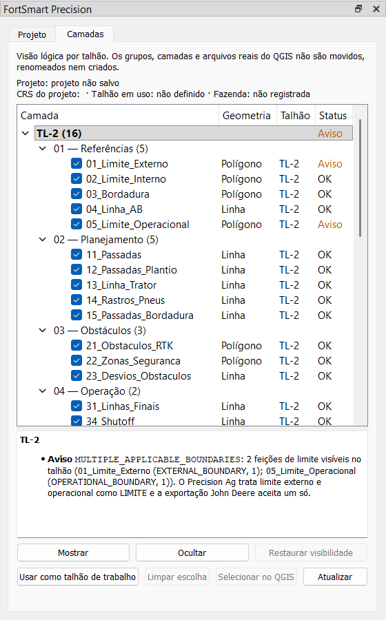

# Etapa 0 / Subfase 0C: organização visual reversível de camadas

**Estado:** concluída, aguardando aprovação.
**Alvo:** FortSmart Precision Planner. O Precision Ag só foi lido, como referência de compatibilidade.
**Backup antes da 0C:** `plugin/backups/fortsmart_precision_antes_etapa0C_20261008_114622` (211 arquivos).

A organização 01 a 05 é só uma árvore lógica dentro do painel FortSmart. A árvore real do QGIS continua sendo a referência do projeto: nenhum grupo, seção, camada, nome, ID, atributo, geometria, CRS ou tabela GeoPackage é criado, movido ou renomeado. A única escrita é a visibilidade do nó original da camada, feita a pedido do usuário e reversível.



*Captura feita fora do QGIS, com um projeto de teste (talhão TL-2 com as 15 camadas do catálogo e limite externo e operacional visíveis juntos).*

## 1. Arquivos criados e modificados

| Arquivo | Situação | Conteúdo |
|---|---|---|
| `core/logical_layer_tree.py` | novo | Modelo puro (sem QGIS): categorias 01–05, Auxiliares e Prévias, classes de camada, status, diagnósticos da 0C, cache por camada, `GeometryRiskChecker` e `VisibilityJournal` |
| `gui/layer_organizer_panel.py` | novo | Aba "Camadas": árvore, detalhes, botões, sinais do QGIS com agrupamento de eventos |
| `gui/main_dock.py` | alterado | `apply_feature_flags()`: com a flag ligada, o conteúdo atual vira a aba "Projeto" e entra a aba "Camadas"; desligada, nada muda |
| `core/project_context.py` | alterado (aditivo) | `resolve_layer_field`, `describe_layer` e `ProjectContextService.describe_layer` aceitam `groups` e `project_layers` já calculados (opcionais; sem eles o resultado é idêntico) |
| `core/persistence_manager.py` | alterado (aditivo) | `table_geometry_type(path, table)`: lê só o cabeçalho da tabela |
| `core/geometry_write_check.py` | alterado (aditivo) | `classify_declared_types(table_type, layer_type)` |
| `tests/unit/test_logical_layer_tree.py` | novo | 24 testes sem QGIS |
| `tests/unit/test_project_context.py` | alterado | Nó falso ganhou `itemVisibilityChecked`/`setItemVisibilityChecked` |
| `tests/qgis/test_layer_organizer_qgis.py` | novo | 9 testes com QGIS |
| `CHANGELOG.md` | alterado | Entrada da 0C |
| `docs/ETAPA_0C_ORGANIZACAO.md`, `docs/img/etapa0c_painel_camadas.png` | novos | Este documento e a captura |

`plugin.py` não mudou. A comparação com o backup mostra que nenhuma linha antiga do plugin foi removida; as mudanças são acréscimos e os parâmetros opcionais acima.

## 2. Estrutura visual implementada

```text
Painel do projeto
├─ [Projeto]   conteúdo atual do dock, sem mudanças
└─ [Camadas]
   Projeto / CRS do projeto / Talhão em uso / Fazenda
   ├─ <talhão> (n)                      um nó por grupo "FORTSMART - <talhão>"
   │  ├─ 01 — Referências (n)           seção real 00_REFERENCIAS
   │  ├─ 02 — Planejamento (n)          seção real 10_PLANEJAMENTO
   │  ├─ 03 — Obstáculos (n)            seção real 20_OBSTACULOS
   │  ├─ 04 — Operação (n)              seção real 30_OPERACAO
   │  ├─ 05 — Análises (n)              seção real 40_SIMULACAO
   │  ├─ Auxiliares (n)                 só quando houver
   │  └─ Prévias (n)                    só quando houver
   └─ Sem talhão definido (n)           fora de grupo, ambíguas ou em grupo inválido
   Colunas: Camada (nome original) | Geometria | Talhão | Status
   Detalhes: avisos do item selecionado
   [Mostrar] [Ocultar] [Restaurar visibilidade]
   [Usar como talhão de trabalho] [Limpar escolha] [Selecionar no QGIS] [Atualizar]
```

- **Categorias:** cada talhão mostra sempre as cinco categorias, mesmo vazias. A dica de cada categoria indica a seção real que ela representa.
- **Classe da camada:**
  - *Oficial:* limites externo, interno e operacional, bordadura, A-B, obstáculos e zonas de segurança.
  - *Operacional:* os demais papéis do catálogo (passadas, linhas finais, shutoff, simulação).
  - *Auxiliar:* camada sem papel, papel só por heurística de nome, ou camada do usuário em `90_AUXILIARES`.
  - *Prévia:* camada temporária ou dentro de `SIM_PREVIEW`.
- **Status:** OK, Nota (só informativos), Aviso, Ambíguo ou Fora da árvore.
  - Uma camada marcada mas oculta por um grupo pai desmarcado aparece em cinza.
- **Visibilidade:**
  - a caixa de seleção e os botões agem no nó original (`setItemVisibilityChecked`), nunca em cópia;
  - selecionar um talhão ou uma categoria aplica a todas as camadas dele;
  - grupos do QGIS não são marcados nem desmarcados.
- **Restauração:**
  - "Restaurar visibilidade" volta o estado anterior de cada camada alterada pelo painel;
  - se o usuário mudou a camada depois, no próprio QGIS, a escolha dele é mantida e listada no relatório;
  - camadas removidas também são listadas.
- **Ações que dependem do talhão:** "Usar como talhão de trabalho" só fica habilitado para talhão identificado pelo grupo. Camada ambígua, sem grupo ou em grupo inválido não habilita. A escolha fica só em memória.
- **Seleção:** o painel não altera a seleção de feições. "Selecionar no QGIS" só torna a camada ativa.

## 3. Compatibilidade com a 0B

| Item da 0B | Uso na 0C |
|---|---|
| `ProjectContextService.describe_layer` | Papel, fonte, talhão (`RESOLVED`/`AMBIGUOUS`/`UNRESOLVED`), CRS, cópia reprojetada e diagnósticos de cada camada |
| `ProjectContextService.available_fields` | Lista de talhões (grupos `FORTSMART - <talhão>`) |
| `ProjectContextService.export_diagnostics` | Limites visíveis, `field_erid` e papéis por talhão, recalculados só quando muda a visibilidade das camadas daquele talhão |
| `ProjectContextService.snapshot`, `set_explicit_field` | Cabeçalho da aba e "Usar como talhão de trabalho" |
| `layer_roles` (`definition_for_role`, `SECTION_ORDER`, `PREVIEW_SECTION`, `AUXILIARY_SECTION`, `role_order_index`, `classify_layer_at`) | Categoria, ordem e detecção de talhão com nome de camada; nenhum catálogo novo |
| `geometry_write_check` | Mensagens e códigos do risco de geometria |

Regras de identificação mantidas:
- o talhão vem do grupo, nunca do nome de uma camada isolada;
- `Todos — Limites` e camadas soltas na raiz ficam em "Sem talhão definido";
- `SIM_PREVIEW` nunca é talhão; um grupo `FORTSMART - SIM_PREVIEW` ou `FORTSMART - <seção>` é marcado como `INVALID_FIELD_GROUP`;
- camada ambígua não é colocada sob nenhum talhão.

Diagnósticos acrescentados pela 0C:

| Código | Severidade | Quando |
|---|---|---|
| `BOUNDARY_VISIBLE_WITH_OTHER` | Aviso | Na camada de limite visível quando o talhão tem mais de uma feição de limite visível (`MULTIPLE_APPLICABLE_BOUNDARIES` da 0B). Nenhum limite é ocultado |
| `DUPLICATE_ROLE_IN_FIELD` | Aviso | O mesmo papel oficial ou operacional em mais de uma camada do talhão |
| `FIELD_GROUP_NAMED_AFTER_LAYER` | Aviso | Talhão com nome de camada (ex.: `FORTSMART - 01_Limite_Externo`); nada é renomeado |
| `DUPLICATE_FIELD_GROUPS` | Aviso | Mais de um grupo para o mesmo talhão |
| `INVALID_FIELD_GROUP` | Aviso | Grupo `FORTSMART - SIM_PREVIEW` ou com nome de seção |
| `GEOMETRY_WRITE_RISK` | Aviso | Camada gerada, em memória, cujo tipo declarado conflita com a tabela já existente no GPKG do talhão (ex.: Multipolígono em tabela Polígono) |
| `UNASSOCIATED_LAYERS` | Nota | Quantas camadas estão fora de talhão ou ambíguas |
| `NO_FIELD_GROUPS` | Nota | Projeto sem nenhum grupo de talhão |
| `DESCRIBE_FAILED` | Aviso | Erro ao ler o contexto de uma camada; ela continua listada |

## 4. Testes e resultados

**Testes novos**

- **Sem QGIS** (`tests/unit/test_logical_layer_tree.py`, 24 testes):
  - catálogo de categorias contra `SECTION_ORDER`;
  - cinco categorias por talhão;
  - vários talhões;
  - camadas sem grupo;
  - `SIM_PREVIEW` na raiz, dentro do talhão e como falso talhão;
  - camada ambígua;
  - classes;
  - montagem somente leitura;
  - erro de leitura reportado;
  - limites visíveis juntos;
  - papéis conflitantes;
  - cópia reprojetada sem metadados;
  - talhão com nome de camada;
  - cache;
  - equivalência do atalho `groups`;
  - diário de visibilidade;
  - risco de geometria.
- **Com QGIS** (`tests/qgis/test_layer_organizer_qgis.py`, 9 testes):

| Teste obrigatório | Onde | Resultado |
|---|---|---|
| Abrir projeto antigo | `OldProjectQgisTest`: projeto salvo com nomes legados (`Limite_Externo`, `05_Passadas`) em GPKG, fechado e reaberto com a aba visível | OK |
| Reconhecer grupos existentes | mesmo teste e `VisibilityQgisTest` | OK |
| Exibir as cinco categorias | itens 01 a 05 presentes na árvore do widget | OK |
| Alternar visibilidade | caixa de seleção e "Ocultar" num talhão inteiro | OK |
| Restaurar visibilidade | árvore idêntica à inicial depois de restaurar | OK |
| Abrir e fechar o painel repetidamente | `DockQgisTest`: 5 ciclos, mesmo número de conexões a cada abertura, zero depois de fechar e depois de `removeDockWidget` | OK |
| Vários talhões | TL-1 e TL-2 | OK |
| Camadas sem grupo | `Todos — Limites` na raiz, entrando e saindo do projeto com a aba aberta | OK |
| `SIM_PREVIEW` | prévia na raiz reconhecida como Prévia, fora de talhão | OK |
| Preservar IDs das camadas | IDs iguais antes e depois, inclusive após reabrir o projeto | OK |
| Preservar seleção | seleção de feições igual antes e depois | OK |
| Preservar GeoPackage | hash e data de modificação do `.gpkg` do talhão e do GPKG legado iguais; `.qgz` igual; projeto não fica "modificado" | OK |
| Flag desligada | dock sem abas, layout idêntico; ligar e desligar sem recriar o dock | OK |

**Regressão**

| Suíte | Antes (0B) | Depois (0C) |
|---|---|---|
| Planner sem QGIS (`tests/unit`, `tests/integration`) | 1021 passaram, 46 pulados | 1045 passaram, 46 pulados |
| Planner com QGIS (`tests/qgis`) | 162 passaram | 171 passaram |
| Precision Ag (pytest) | 155 passaram, 26 subtestes | 155 passaram, 26 subtestes |
| Precision Ag com QGIS (unittest) | 14 OK | 14 OK |
| Exportações John Deere dual e 20\|20 (`gerar_baseline.py` contra `ag_2.9.20_export_hashes.json`) | linha de base | 96 de 96 hashes iguais, nenhuma chave a mais ou a menos |
| Algoritmos de Processing | 13 | 13 |

## 5. Impacto de desempenho

- **Inicialização do plugin:** sem impacto. Continuam 164 módulos carregados, como na 0B. Os módulos novos só são importados quando a flag está ligada e o painel é aberto.
- **Com a aba fechada ou em outra aba:** nenhum sinal fica conectado.
- **Com a aba visível:**
  - os eventos do QGIS são agrupados por 200 ms;
  - mudanças de visibilidade reaproveitam o contexto de cada camada e só refazem os avisos de exportação do talhão afetado;
  - edição concluída ou metadado alterado invalidam só aquela camada;
  - mudanças na estrutura da árvore ou na lista de camadas refazem tudo.
- **Geometria:** nenhum processamento geométrico na interface. O risco de gravação compara só tipos declarados. O cabeçalho da tabela é lido uma vez e fica em cache enquanto a data do arquivo não mudar.

Medido com projetos de teste no QGIS 3.44, mediana de 5 execuções:

| Camadas no projeto | Montagem completa | Atualização sem mudança | Após mudar visibilidade |
|---|---|---|---|
| 85 (4 talhões) | 22 ms | 5 ms | 5 ms |
| 213 (12 talhões) | 78 ms (618 ms antes do ajuste em `project_context`) | 13 ms | 13 ms |
| 501 (30 talhões) | 328 ms | 38 ms | 43 ms |

O ajuste foi passar a lista de grupos já calculada para `resolve_layer_field`; antes, cada camada refazia a varredura da árvore inteira. Um teste confirma que o resultado é idêntico com e sem a lista.

## 6. Riscos restantes

1. **Ciclo de vida do dock (já existia):** `FortSmartDock.closeEvent` desconecta `currentLayerChanged` e não reconecta quando o painel é reaberto. O cartão "Camada ativa" da aba Projeto para de acompanhar a camada depois de fechar e reabrir. A aba Camadas não depende disso, porque reconecta ao ficar visível. Não foi corrigido aqui para não mudar o comportamento atual; é candidato à 0D.
2. **Restauração só nesta sessão:** o estado anterior da visibilidade fica em memória. Trocar ou reabrir o projeto, recarregar o plugin ou desligar a flag descarta o histórico; a restauração passa a não ter o que desfazer.
3. **Edição direta pelo provedor:** um motor que altere feições pelo `dataProvider()` de uma camada já existente, sem modo de edição, não dispara sinal. Os avisos dessa camada só se atualizam com "Atualizar" ou com uma mudança na árvore.
4. **Risco de geometria pelo tipo declarado:**
   - pode avisar uma camada Multipolígono cujas feições têm todas uma parte só;
   - não detecta geometria que ficaria inválida ao converter;
   - a verificação feição por feição (`diagnose_geometry_write`, da 0B) continua sem chamador na interface, porque é pesada demais para a thread da interface.
5. **Projetos muito grandes:** com cerca de 500 camadas, uma mudança de estrutura custa cerca de 330 ms na interface.
6. **Mesma camada em dois nós da árvore:** a visibilidade age no primeiro nó encontrado.
7. **Camada ambígua:** fica em "Sem talhão definido" no painel, mas o Precision Ag continua exportando-a pelo grupo físico. O diagnóstico avisa, mas o painel não impede a exportação.
8. **Plugin instalado no QGIS:** o perfil do usuário ainda tem a versão anterior à 0B. A aba só aparece depois de instalar a versão atual e ligar a flag.

## 7. Ativar e desativar

A chave é `fortsmart_precision/flags/ENABLE_LAYER_ORGANIZER_V1`, guardada nas configurações do QGIS (padrão `false`).

**Ativar**, por um destes caminhos:
- no QGIS, abrir **Configurações → Opções → Avançado**, criar ou editar `fortsmart_precision/flags/ENABLE_LAYER_ORGANIZER_V1` com valor `true`;
- ou, no console Python do QGIS:

```python
from fortsmart_precision.feature_flags import ENABLE_LAYER_ORGANIZER_V1, set_enabled
set_enabled(ENABLE_LAYER_ORGANIZER_V1, True)
```

Depois, abrir (ou reabrir) **FortSmart Precision → Painel do projeto**. A aba "Camadas" aparece ao lado de "Projeto".

**Desativar:** gravar `false` pelo mesmo caminho e reabrir o painel. A aba some e o dock volta ao layout anterior, sem reiniciar o QGIS. Nada precisa ser migrado. As únicas mudanças possíveis são as de visibilidade feitas pelo usuário; elas ficam no projeto como qualquer mudança feita na árvore do QGIS.

## 8. Matriz de lacunas da Etapa 0

Levantamento feito no código atual do Planner, não nos relatórios anteriores:

| Subfase | Estado | Evidência no código | O que falta |
|---|---|---|---|
| 0A Auditoria | Concluída | `docs/ETAPA_0_AUDITORIA.md`, linha de base `docs/baseline_etapa0/` | — |
| 0B Contexto | Concluída | `core/project_context.py`, `feature_flags.py`, `core/geometry_write_check.py`, 29 + 9 testes | — |
| 0C Organização | Concluída (aguarda aprovação) | Este documento | — |
| 0D Painel AgroCAD | Pendente | Só a flag `ENABLE_AGROCAD_PANEL_V1`, sem uso. A base existente é o `FortSmartDock` (agora com abas) | Seções Editor/Obstáculos/Terreno/Planejamento, "Ferramenta ativa" (camada, seleção, parâmetros), Prévia/Aplicar/Cancelar, atalhos para os diálogos existentes, ações não implementadas desabilitadas, teste de descarregar o plugin |
| 0E Seleção e prévia | Pendente | Só a flag `ENABLE_PREVIEW_MANAGER_V1`, sem uso. Prévias espalhadas: `QgsRubberBand` em `capture_ab_line_tool.py`, `obstacle_detour_dialog.py`, `route_simulation_renderer.py`, `route_warning_renderer.py`; camadas de memória em `strategy_preview.py` e `SIM_PREVIEW` | Leitor de seleção nativa (uma ou várias linhas, papel, talhão, CRS, ID estável) e gerenciador central `show_geometry`/`show_geometries`/`clear`/`dispose` com limpeza ao cancelar, trocar projeto e remover camada |
| 0F Inspetor DEM | Pendente | Só a flag `ENABLE_DEM_INSPECTOR_V1`, sem uso; `LayerSummaryWidget` mostra apenas "Raster" | CRS, resolução, NoData, cobertura do talhão, unidade horizontal e vertical (declarada pelo usuário quando desconhecida), incompatibilidades |
| 0G Estabilização | Pendente | Regressões rodadas a cada subfase | Revisão integrada 0A–0F, regressão de todos os exportadores com linha de base, testes de interface integrados, testes de caracterização dos 11 algoritmos sem cobertura própria, `docs/ETAPA_0_FECHAMENTO.md` e `docs/CONTRATO_TRAFEGO_CONTROLADO_V1.md` |
