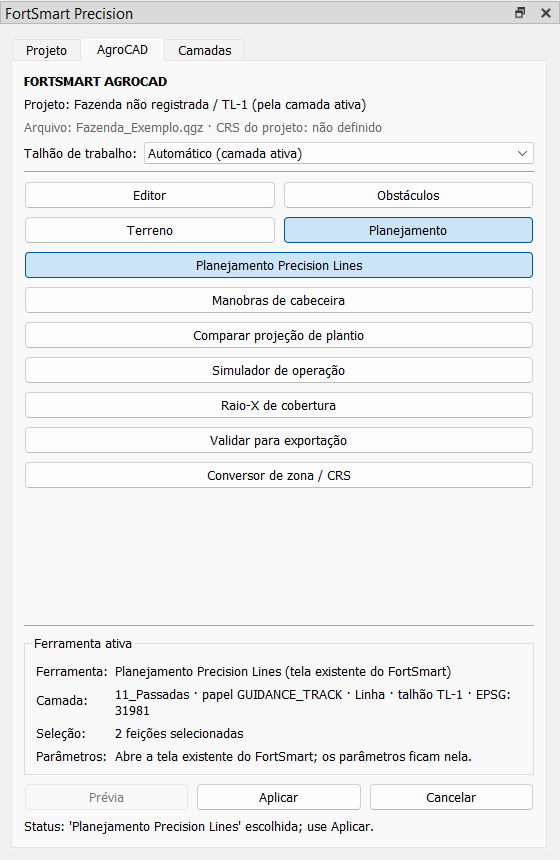

# Etapa 0 / Subfase 0D — Painel AgroCAD

Estado: **concluída, aguardando aprovação**. A 0E não foi iniciada.

## 1. O que a 0D entrega

- Uma aba **"AgroCAD"** dentro do dock existente "FortSmart Precision". Não há janela nova e o mapa do QGIS continua sendo a área de trabalho.
- O painel apenas **aciona o que já existe**:
  - ações nativas do QGIS;
  - as mesmas `QAction` do menu do plugin;
  - a pilha de desfazer da camada ativa.
- Nenhum algoritmo de linha A-B, curva, bordadura, desvio, simulação, Processing ou exportação foi copiado ou alterado.
- O painel não grava nada: camadas, grupos, nomes, IDs, atributos, geometrias, CRS e tabelas GeoPackage ficam intactos.
- Projetos antigos funcionam sem migração. Uma camada sem metadados FortSmart aparece como "sem papel FortSmart", e o talhão aparece como "Talhão não definido".



## 2. Como ligar e desligar

A chave é `ENABLE_AGROCAD_PANEL_V1` e fica **desligada por padrão**. Desligada, o dock fica exatamente como antes.

No console Python do QGIS:

```python
from fortsmart_precision.feature_flags import ENABLE_AGROCAD_PANEL_V1, set_enabled
set_enabled(ENABLE_AGROCAD_PANEL_V1, True)   # False volta ao painel anterior
```

Depois, abra (ou reabra) **FortSmart Precision → Painel do projeto**.

As duas chaves de interface são independentes:

| `ENABLE_AGROCAD_PANEL_V1` | `ENABLE_LAYER_ORGANIZER_V1` | Dock |
|---|---|---|
| desligada | desligada | painel anterior, sem abas |
| ligada | desligada | Projeto · AgroCAD |
| desligada | ligada | Projeto · Camadas (como na 0C) |
| ligada | ligada | Projeto · AgroCAD · Camadas |

Ao desligar uma chave, a aba correspondente é removida, os sinais dela são desconectados e o widget é liberado. Com as duas desligadas, o layout original volta.

## 3. Estrutura do painel

O painel segue o modelo da especificação:

- **Cabeçalho**:
  - "FORTSMART AGROCAD";
  - "Projeto: Fazenda / Talhão";
  - arquivo do projeto e CRS do projeto;
  - "Talhão de trabalho", com "Automático (camada ativa)" ou um dos talhões que têm grupo `PROJETO_<talhão>`.
- **Seções**: Editor, Obstáculos, Terreno e Planejamento (botões 2 × 2). Cada seção lista as suas ferramentas.
- **Ferramenta ativa**:
  - ferramenta e origem (ação nativa, tela existente ou pilha de desfazer);
  - camada: nome, papel FortSmart, geometria, talhão, CRS e se está em edição;
  - seleção: quantidade de feições selecionadas;
  - parâmetros: o que a ferramenta faz e, quando ela está bloqueada, o motivo.
- **Botões**:
  - **Prévia**: desabilitado; a prévia central é a 0E.
  - **Aplicar**: aciona a ferramenta escolhida.
  - **Cancelar**: limpa a escolha e, se uma ferramenta de mapa do QGIS foi ativada pelo painel, volta para a navegação (`actionPan`).
- **Status**: resultado da última ação, inclusive falhas, com a mensagem do erro. Nada é ignorado em silêncio.

Clicar numa ferramenta só a escolhe. **Aplicar** é o único botão que executa alguma coisa.

### Talhão de trabalho compartilhado

O dock cria um único `ProjectContextService` para as abas AgroCAD e Camadas. Assim, o talhão escolhido numa aba vale na outra.

- A escolha é só desta sessão; não é gravada no projeto.
- A escolha é limpa ao fechar ou trocar de projeto.

## 4. Ferramentas

O catálogo fica em `core/agrocad_tools.py`, sem dependência de Qt. Ele define cada ferramenta e o seu estado.

### Editor

| Ferramenta | Origem | Exige |
|---|---|---|
| Alternar edição | `iface.actionToggleEditing` | camada vetorial |
| Salvar edições | `iface.actionSaveActiveLayerEdits` | camada em edição |
| Selecionar | `iface.actionSelect` | camada vetorial |
| Selecionar por retângulo | `iface.actionSelectRectangle` | camada vetorial |
| Selecionar por polígono | `iface.actionSelectPolygon` | camada vetorial |
| Editar vértices | `iface.actionVertexToolActiveLayer` | camada em edição |
| Dividir feições | `iface.actionSplitFeatures` | camada em edição |
| Desfazer | `layer.undoStack().undo()` | camada em edição, com algo para desfazer |
| Refazer | `layer.undoStack().redo()` | camada em edição, com algo para refazer |
| Unir feições | — | **desabilitada**: não há método estável em `QgisInterface` |

### Obstáculos

| Ferramenta | Origem |
|---|---|
| Desvio de obstáculo | ação do menu (`ObstacleDetourDialog`) |
| Cortar linhas por obstáculos | ação do menu (`PlantingLineCutDialog`) |

### Terreno

| Ferramenta | Origem |
|---|---|
| Inspetor DEM | **desabilitada**: Subfase 0F |
| Declividade | **desabilitada**: fora da Etapa 0 |
| Curvas de nível | **desabilitada**: fora da Etapa 0 |

### Planejamento

| Ferramenta | Origem |
|---|---|
| Planejamento Precision Lines | ação do menu (`FortSmartWorkspaceDialog`) |
| Manobras de cabeceira | ação do menu (`HeadlandTurnsDialog`) |
| Comparar projeção de plantio | ação do menu (só existe com `ENABLE_STRATEGY_ANALYZER`) |
| Simulador de operação | ação do menu (`RouteSimulationDialog`) |
| Raio-X de cobertura | ação do menu (Processing `simulate_real_operation`) |
| Validar para exportação | ação do menu (`ExportReadinessDialog`) |
| Conversor de zona / CRS | ação do menu (`CrsZoneConverterDialog`) |

"Organizar camadas FortSmart" e "Persistir camadas FortSmart" **não** foram colocadas no painel, porque movem ou gravam camadas. Elas continuam no menu, como antes.

### Regras de habilitação

- **Ferramenta indisponível** (catálogo): o botão fica desabilitado, e a dica explica o motivo.
- **Ação ausente**: se a ação nativa ou a ação do plugin não existir (por exemplo, a comparação de projeção com a sua chave desligada), o botão continua clicável para mostrar o motivo. **Aplicar** fica desabilitado, e, se for chamado, o status informa "Ação nativa indisponível…" ou "Ação do plugin indisponível."
- **Estado da camada**: a exigência (vetorial, em edição, pilha com algo para desfazer) é verificada de novo a cada mudança de camada ativa, de seleção, de edição e da pilha de desfazer.

## 5. Contexto e eventos

Os sinais ficam conectados só enquanto a aba está visível.

| Evento | Atualiza |
|---|---|
| `iface.currentLayerChanged` | contexto completo e liga os sinais da nova camada ativa |
| `selectionChanged` e `undoStack.indexChanged` da camada ativa | só a seleção e o estado das ferramentas (não recalcula o projeto) |
| `editingStarted` e `editingStopped` da camada ativa | linha "Camada" e ferramentas |
| `layersWillBeRemoved` | desliga os sinais da camada antes de ela ser apagada |
| `layersAdded`, `layersRemoved` e mudanças na árvore (`addedChildren`, `removedChildren`, `nameChanged`) | contexto completo |
| `cleared` e `readProject` | contexto completo, limpa o talhão escolhido e a ferramenta |

As atualizações passam por um temporizador de 80 ms, para que várias mudanças seguidas virem uma só. Só uma camada tem sinais ligados por vez.

## 6. Ciclo de vida: correções isoladas

Duas falhas antigas do dock foram corrigidas, porque a 0D exige testar abrir, fechar, reabrir e descarregar.

1. **Reabertura**: o `closeEvent` do dock desconectava `currentLayerChanged` e nunca reconectava. Depois de fechar e reabrir o painel, o quadro "Camada ativa" parava de acompanhar o QGIS (risco 1 da 0C). Agora o `showEvent` reconecta uma única vez, com controle por estado.
2. **Descarregamento**: `unload()` só escondia o dock, e o sinal da camada ativa continuava apontando para ele. Agora `unload()` chama `dock.shutdown()`, que desconecta o dock e as abas, antes de `removeDockWidget`, e libera o dock com `deleteLater()`.

Nada mais no `plugin.py` mudou além disso. A única outra alteração foi `_tool_actions()`, que entrega ao dock as ações já existentes; os menus, a barra de ferramentas e o Processing ficaram iguais.

## 7. Arquivos

| Arquivo | Mudança |
|---|---|
| `core/agrocad_tools.py` | **novo**; catálogo puro e `tool_state` |
| `gui/agrocad_panel.py` | **novo**; `AgroCadPanel` |
| `gui/main_dock.py` | abas por chave (AgroCAD e Camadas), contexto compartilhado, `set_tool_actions`, `shutdown`, reconexão no `showEvent` |
| `gui/layer_organizer_panel.py` | parâmetro opcional `service=` (sem ele, o comportamento é o da 0C) |
| `plugin.py` | `_tool_actions()`, `set_tool_actions` ao criar o dock e `shutdown` + `deleteLater` no `unload` |
| `tests/unit/test_agrocad_tools.py` | **novo**; 10 testes |
| `tests/qgis/test_agrocad_panel_qgis.py` | **novo**; 15 testes |

O carregamento do plugin (`initGui`) não importa nada novo. O catálogo `core/agrocad_tools.py` é importado quando o painel do projeto é aberto. `gui/agrocad_panel.py` só é importado com a chave ligada. O backup está em `plugin/backups/fortsmart_precision_antes_etapa0D_20261008_120340`.

## 8. Testes e regressão

Os testes novos em QGIS real cobrem:

- projeto antigo só lido (árvore e propriedades idênticas depois de escolher e aplicar);
- cabeçalho seguindo a camada ativa e a escolha explícita;
- seleção atualizando sem recalcular o contexto;
- camada ativa removida;
- troca de projeto;
- ações indisponíveis desabilitadas;
- ação do plugin acionada pela mesma `QAction`;
- ferramenta de mapa nativa e Cancelar voltando para a navegação;
- ação nativa ausente informada, não ignorada;
- desfazer e refazer pela pilha da camada;
- chaves desligadas mantendo o layout;
- abas por chave e contexto compartilhado;
- abrir, fechar e reabrir 5 vezes com o mesmo número de conexões, e zero depois de fechar;
- dock reaberto voltando a seguir a camada ativa;
- `unload()` do plugin sem nenhum sinal apontando para o dock.

| Suíte | 0C | 0D |
|---|---|---|
| Planner unit + integration | 1045 passed, 46 skipped | **1055 passed**, 46 skipped |
| Planner QGIS | 171 passed | **186 passed** |
| Precision Ag pytest | 155 passed | 155 passed |
| Precision Ag QGIS (unittest) | 14 OK | 14 OK |
| Hashes de exportação do Precision Ag (linha de base da 0A) | 96/96 | **96/96 iguais** |

## 9. Desempenho

Medido com a aba visível, em projetos sintéticos de 4 camadas por talhão.

| Camadas | Contexto completo | Só seleção |
|---|---|---|
| 84 | 5 ms | 0,1 ms |
| 212 | 13 ms | 0,1 ms |
| 500 | 31 ms | 0,1 ms |

## 10. Riscos e limitações

1. **Aplicar dispara a mesma ação do menu.** Telas que abrem modais (Conversor de zona/CRS) bloqueiam o painel até serem fechadas, como no menu.
2. **As ações nativas agem sobre a camada ativa do QGIS**, não sobre o talhão escolhido no painel. O cabeçalho mostra os dois para evitar confusão, mas não impede o uso.
3. **"Unir feições" ficou de fora**, porque `QgisInterface` não expõe a ação. Localizar a ação pelo `objectName` do menu seria frágil.
4. **Seleção sem identificador estável**: a seleção mostra só a quantidade. O papel, o talhão e o identificador estável por feição são da 0E.
5. **Fazenda não registrada é comum em projetos antigos.** O cabeçalho mostra "Fazenda não registrada" em vez de inventar um nome.
6. **O plugin instalado no perfil do QGIS ainda é anterior à 0B.** As mudanças estão só na cópia de desenvolvimento.

## 11. Matriz 0A–0G

| Subfase | Situação |
|---|---|
| 0A Auditoria | concluída |
| 0B Contexto e chaves | concluída |
| 0C Árvore lógica de camadas | concluída |
| **0D Painel AgroCAD** | **concluída, aguardando aprovação** |
| 0E Leitor de seleção + gerenciador de prévia | pendente (`ENABLE_PREVIEW_MANAGER_V1` sem uso) |
| 0F Inspetor DEM | pendente (`ENABLE_DEM_INSPECTOR_V1` sem uso; Terreno desabilitado no painel) |
| 0G Estabilização, `ETAPA_0_FECHAMENTO.md`, `CONTRATO_TRAFEGO_CONTROLADO_V1.md` | pendente |

Próximo passo, se aprovado: a **0E**. Ela traz um leitor da seleção nativa (camada, papel, talhão, CRS e identificador estável) e o gerenciador central de prévias com `QgsRubberBand`. Com isso, o botão **Prévia** do painel será ligado.
