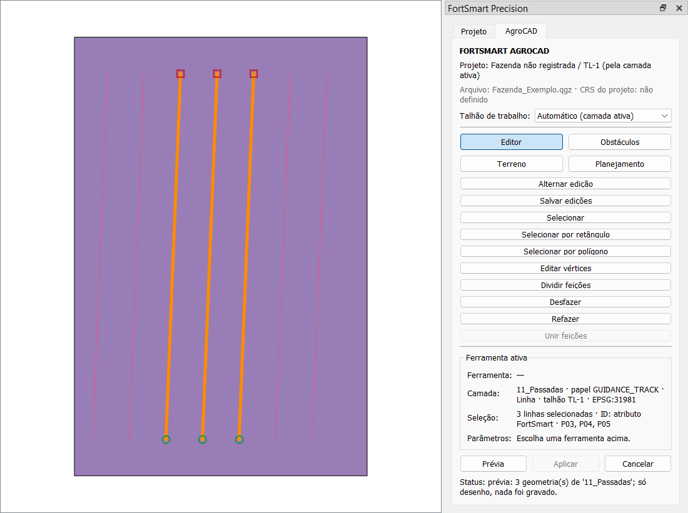

# Etapa 0 / Subfase 0E — Seleção nativa e prévia central

Estado: **concluída, aguardando aprovação**. A 0F não foi iniciada.

## 1. O que a 0E entrega

- **Leitor da seleção nativa do QGIS** (`core/selection_reader.py`). Ele reconhece:
  - uma linha ou várias linhas selecionadas;
  - a camada ativa;
  - o papel semântico;
  - o talhão;
  - o CRS;
  - o identificador estável de cada feição.

  Não existe seleção paralela: cada leitura consulta `selectedFeatureIds()` da camada naquele momento.
- **Gerenciador central de prévias** (`gui/preview_manager.py`), feito só com `QgsRubberBand`:
  - não cria camada nem GeoPackage;
  - não altera camadas do projeto;
  - limpa sozinho ao trocar de projeto e ao remover a camada de origem.
- **Integração no painel AgroCAD**:
  - a linha "Seleção" passa a mostrar o resultado do leitor;
  - o botão **Prévia** desenha a seleção atual, em laranja, com início em verde e fim em vermelho para as linhas.
- **Só infraestrutura genérica.** Linhas de pulverização, rastros, faixas de pneus, cruzamentos e exclusão de sementes **não** foram gerados. O gerenciador apenas aceita estilos novos para esses usos futuros.



## 2. Como ligar e desligar

A chave é a já existente `ENABLE_PREVIEW_MANAGER_V1`, **desligada por padrão**. Não foi criada nenhuma chave nova. Ela vale para o leitor no painel e para a prévia, e só aparece no painel AgroCAD, ou seja, também é preciso ligar `ENABLE_AGROCAD_PANEL_V1`.

```python
from fortsmart_precision.feature_flags import ENABLE_PREVIEW_MANAGER_V1, set_enabled
set_enabled(ENABLE_PREVIEW_MANAGER_V1, True)   # False volta ao painel da 0D
```

Com a chave desligada:

- a linha "Seleção" mostra só a quantidade, como na 0D;
- **Prévia** fica desabilitado;
- o gerenciador nunca é criado.

## 3. Leitor da seleção

`read_selection(layer, service, limit=500)` devolve um `SelectionInfo`, ou `None` quando não há camada vetorial. Ele contém:

- `layer_id`, `layer_name`;
- `role`, `role_trusted`, `field` e `crs`, todos vindos de `ProjectContextService.describe_layer` (0B);
- `geometry_code`, com `is_line`, `is_polygon`, `single_line` e `multiple_lines`;
- `count`, `features` (um `FeatureIdentity` por feição, até o limite) e `truncated`;
- `diagnostics` e `text()`, um resumo legível.

A leitura busca só o atributo de identificação, sem geometria, e não altera a seleção nem a camada. `selected_geometries(layer)` devolve `(fid, geometria)` no CRS da camada, para a prévia.

### Identificador estável

A origem é escolhida da mais para a menos estável:

| Ordem | Origem | Quando |
|---|---|---|
| 1 | atributo FortSmart | a camada tem `fs_id` (motores e Processing) ou `line_id` (passadas e plantio) preenchido |
| 2 | chave do arquivo | o provedor tem chave primária, como o `fid` do GeoPackage |
| 3 | só nesta sessão | camada de memória: o `fid` vale enquanto a camada existir |
| 4 | pode mudar após edição | formato sem chave, como shapefile |
| — | feição nova não salva | `fid` negativo do buffer de edição; nunca é tratada como estável |

`FeatureIdentity.key` tem a forma `ORIGEM:valor` (por exemplo, `ATTRIBUTE:P03`).

Diagnósticos (nada é ignorado em silêncio):

| Código | Nível | Situação |
|---|---|---|
| `DUPLICATE_IDENTITY` | aviso | o mesmo `fs_id`/`line_id` aparece em mais de uma feição selecionada |
| `UNSTABLE_IDENTITY` | aviso | formato sem chave própria |
| `SESSION_IDENTITY` | nota | camada temporária |
| `UNSAVED_FEATURES` | nota | há feições novas não salvas |
| `SELECTION_TRUNCATED` | nota | a seleção passou de 500 feições; só as primeiras foram identificadas |

No painel, o primeiro aviso aparece na linha "Seleção", e todos os diagnósticos ficam na dica dessa linha.

## 4. Gerenciador de prévias

O contrato conceitual foi adaptado às APIs reais do QGIS:

```python
manager = PreviewManager(canvas, project=None, parent=None)
manager.show_geometry(geometry, style="line", *, crs=None, source_layer_id=None) -> bool
manager.show_geometries(geometries, styles="line", *, crs=None, source_layer_id=None) -> int
manager.clear(source_layer_id=None) -> int      # tudo, ou só as prévias de uma camada
manager.dispose()                               # final e idempotente
manager.register_style(name, PreviewStyle(...)) # categorias futuras sem mexer no gerenciador
```

Como funciona:

- **CRS:** `crs` é o da geometria; o `QgsRubberBand` reprojeta para o CRS do mapa.
- **Agrupamento:** as geometrias ficam numa banda por (estilo, tipo de geometria, camada de origem), em vez de uma banda por geometria.
- **Geometrias que não são desenhadas:** vazias ou nulas não são desenhadas, e `show_geometry` devolve `False`.
- **Erros:** estilo desconhecido gera `KeyError`; quantidade de estilos diferente da de geometrias, `ValueError`; desenhar depois de `dispose`, `RuntimeError`.

Estilos iniciais:

| Estilo | Uso |
|---|---|
| `line` | linha provisória (azul) |
| `polygon` | polígono provisório (contorno laranja, preenchimento translúcido) |
| `point` | ponto (azul) |
| `highlight` | destaque da seleção (laranja, grosso) |
| `reference` | referência (cinza tracejado) |
| `warning` | alerta (vermelho pontilhado) |
| `start` / `end` | início (círculo verde) e fim (quadrado vermelho) da linha |

### Limpeza e sinais

| Situação | Efeito |
|---|---|
| `project.cleared` / `readProject` | limpa tudo |
| `layersWillBeRemoved` | limpa só as prévias daquela camada de origem |
| canvas destruído | larga as referências e se desliga |
| painel: Cancelar | limpa |
| painel: seleção ou geometria mudou (`selectionChanged`, desfazer/refazer) | limpa, porque a prévia ficaria velha |
| painel: camada ativa mudou | limpa |
| painel escondido (fechar o dock, trocar de aba) | limpa |
| `unload()` do plugin / painel desligado | `dispose()` |

O gerenciador só mantém sinais conectados enquanto há alguma prévia na tela: são 4 sinais quando ativo e 0 quando vazio. Repetir mostrar e limpar não acumula conexões.

## 5. Arquivos

| Arquivo | Mudança |
|---|---|
| `core/selection_reader.py` | **novo** |
| `gui/preview_manager.py` | **novo** |
| `gui/agrocad_panel.py` | linha "Seleção" pelo leitor, botão Prévia, limpeza nos eventos acima (tudo condicionado à chave) |
| `tests/unit/test_selection_reader.py` | **novo**; 8 testes |
| `tests/qgis/test_selection_preview_qgis.py` | **novo**; 19 testes |

Nenhum motor, gerador, exportador, algoritmo de Processing, papel de camada ou tela existente foi alterado. O backup está em `plugin/backups/fortsmart_precision_antes_etapa0E_20261008_184131`.

## 6. Testes e regressão

Os testes novos em QGIS real cobrem:

- **Leitor:**
  - uma linha e várias linhas, com papel, talhão e CRS;
  - a leitura segue o QGIS e não guarda seleção própria;
  - GeoPackage usa a chave do arquivo, e shapefile é marcado como instável;
  - feição nova, identificador repetido e limite;
  - sem camada.
- **Gerenciador:**
  - linhas, polígonos e pontos em bandas distintas, sem camadas nem arquivos;
  - estilos visualmente distintos;
  - estilos futuros registrados;
  - reprojeção para o mapa;
  - mostrar e limpar 10 vezes sem acumular sinais;
  - troca de projeto;
  - remoção da camada de origem limpando só as prévias dela;
  - `dispose` final e idempotente;
  - geometria vazia não desenhada.
- **Painel:**
  - chave desligada igual à 0D;
  - prévia sem gravar nada (árvore, propriedades e camada idênticas);
  - limpeza ao cancelar, mudar a seleção, mudar a camada ativa e remover a camada;
  - esconder limpa e `shutdown` descarta;
  - sem mapa, a Prévia fica desabilitada com o motivo.

| Suíte | 0D | 0E |
|---|---|---|
| Planner unit + integration | 1055 passed | **1066 passed**, 46 skipped |
| Planner QGIS | 186 passed | **212 passed** |
| Precision Ag pytest | 155 passed | 155 passed |
| Precision Ag QGIS (unittest) | 14 OK | 14 OK |
| Hashes de exportação do Precision Ag | 96/96 | **96/96 iguais** |

**Observação:** os totais do Planner incluem testes de outro trabalho feito em paralelo na mesma pasta, entre a 0D e a 0E. São de pulverização e tráfego controlado, por exemplo `test_controlled_traffic_selection.py`, `test_spatial_tire_shutoff.py` e `test_sprayer_traffic_configuration.py`. Os testes próprios da 0E são 8 unitários e 19 QGIS; o restante do aumento vem desse outro trabalho. Os arquivos desse trabalho (`tire_track_engine.py`, `sprayer_traffic_engine.py`, `shutoff_engine.py`, `cross_workflow.py`, `fortsmart_workspace_dialog.py` e outros) **não foram tocados pela 0E**, e todos os testes deles passaram junto.

## 7. Riscos e limitações

1. **As prévias antigas continuam como estavam.** O `CaptureABLineTool` tem uma banda que nunca é removida (risco da 0A). O `DetourPreview`, os renderizadores da simulação, o `StrategyPreviewManager` (camadas de memória) e o `SIM_PREVIEW` também seguem iguais. Migrar esses usos para o gerenciador central mexeria em telas e motores protegidos, então fica para uma etapa própria.
2. **A unicidade de `fs_id`/`line_id` só é verificada dentro da seleção**, não na camada inteira.
3. **O identificador de shapefile e o de camada de memória não são estáveis entre sessões.** O leitor avisa, mas não corrige.
4. **Seleções acima de 500 feições** são contadas inteiras, mas só as 500 primeiras são identificadas e desenhadas.
5. **O destaque amarelo da seleção do próprio QGIS continua visível** sob a prévia; os dois mostram as mesmas feições.
6. **O plugin instalado no perfil do QGIS ainda é anterior à 0B.**

## 8. Matriz 0A–0G

| Subfase | Situação |
|---|---|
| 0A Auditoria | concluída |
| 0B Contexto e chaves | concluída |
| 0C Árvore lógica de camadas | concluída |
| 0D Painel AgroCAD | concluída |
| **0E Seleção nativa + prévia central** | **concluída, aguardando aprovação** |
| 0F Inspetor DEM | pendente (`ENABLE_DEM_INSPECTOR_V1` sem uso; Terreno desabilitado no painel) |
| 0G Estabilização, `ETAPA_0_FECHAMENTO.md`, `CONTRATO_TRAFEGO_CONTROLADO_V1.md` | pendente |

Próximo passo, se aprovado: a **0F**, o inspetor DEM. Ele vai identificar a raster, o CRS, a resolução, o NoData, a cobertura do talhão e as unidades horizontal e vertical, e informar incompatibilidades, sem análises avançadas.
