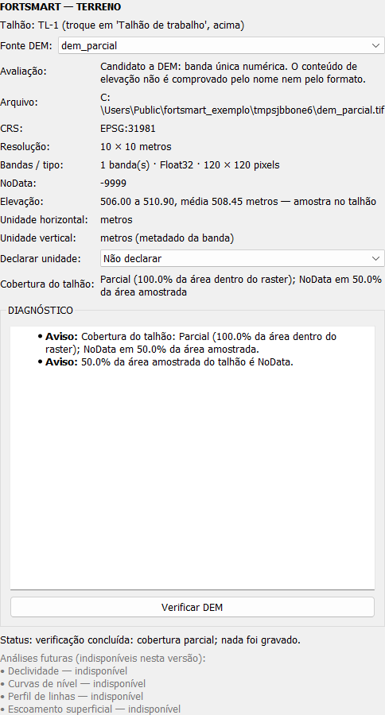

# Etapa 0 / Subfase 0F — Inspetor DEM (somente leitura)

Estado: **concluída, aguardando aprovação**. A 0G não foi iniciada.

## 1. O que a 0F entrega

A seção **Terreno** do painel AgroCAD ganha um inspetor que diz se um raster carregado no QGIS serve como modelo de elevação (DEM) para o talhão de trabalho. Ele mostra:

- de onde vem o raster: nome, arquivo, provedor, CRS, resolução, extensão, bandas, tipo de dado e NoData;
- as unidades horizontal e vertical, com a origem de cada uma;
- a cobertura do talhão: completa, parcial ou ausente, com a fração de NoData;
- a faixa de elevação na amostra do talhão.

Tudo é só leitura:

- o raster não é reprojetado, copiado nem alterado;
- o CRS da camada não muda;
- nenhuma camada, grupo, propriedade ou GeoPackage é criado ou gravado.

Análises de terreno (declividade, curvas de nível, perfil de linhas, escoamento superficial) **não** foram feitas. Elas aparecem na tela como "indisponível", em texto cinza e sem botões.



A imagem mostra um DEM sintético que cobre o talhão, mas com metade da área amostrada em NoData. O resultado é "cobertura parcial", com dois avisos.

## 2. Como ligar e desligar

A chave é a já existente `ENABLE_DEM_INSPECTOR_V1`, **desligada por padrão**; nenhuma chave nova foi criada. O inspetor fica dentro do painel AgroCAD, então também é preciso ligar `ENABLE_AGROCAD_PANEL_V1`.

```python
from fortsmart_precision.feature_flags import ENABLE_DEM_INSPECTOR_V1, set_enabled
set_enabled(ENABLE_DEM_INSPECTOR_V1, True)   # False volta à seção Terreno da 0D
```

A chave é lida quando o painel é montado ou atualizado:

- **Desligada:** a seção Terreno fica exatamente como na 0D, com os quatro botões desabilitados, e o inspetor nunca é criado.
- **Ligada:** o inspetor ocupa a seção.
- **Ao desligar de novo:** o inspetor é descartado (sinais desligados e tarefa cancelada) e os botões da 0D voltam.

## 3. Descoberta e metadados

**Lista de rasters.** A caixa "Fonte DEM" lista todas as camadas raster do projeto:

- primeiro as candidatas;
- depois as demais, com o sufixo "(não recomendado)" e uma dica com o motivo.

Toda raster pode ser inspecionada; nada é escondido nem pulado em silêncio. Montar a lista não abre nenhum arquivo: usa só o número de bandas, o tipo de dado e o provedor.

**Candidata não é DEM comprovado.** Uma camada é candidata quando tem uma única banda numérica (inteira ou de ponto flutuante) num arquivo local (provedor `gdal`). Mesmo assim, a tela diz: "O conteúdo de elevação não é comprovado pelo nome nem pelo formato". Nem banda única nem o nome do arquivo bastam para tratar a raster como DEM.

| Situação | Avaliação |
|---|---|
| banda única, inteira ou float, provedor `gdal` | candidata |
| várias bandas | não recomendado: provável imagem multibanda |
| tipo `Byte` ou cor (ARGB) | não recomendado: provável imagem ou classificação |
| serviço (WMS, XYZ…) | não recomendado: não é um arquivo local de valores |

**Metadados.** São lidos ao escolher a raster, só do cabeçalho; nenhum pixel é lido nesse momento. O NoData considera o valor da fonte e as faixas definidas pelo usuário no QGIS.

## 4. Unidades

A **unidade horizontal** vem do CRS da raster:

- raster sem CRS gera o erro `RASTER_WITHOUT_CRS` e não pode ser verificada;
- CRS em graus gera o aviso `HORIZONTAL_IN_DEGREES`; a resolução aparece em graus, com a conversão aproximada em metros na latitude do centro, e graus nunca são tratados como metros.

A **unidade vertical** segue esta ordem de origem:

| Ordem | Origem | Quando |
|---|---|---|
| 1 | declarada pelo usuário | "Declarar unidade: metros/pés"; vale só nesta sessão e não altera arquivo nem projeto |
| 2 | metadado da banda | `GetUnitType()` do GDAL (`m`, `metre`, `ft`, `US survey foot`…) |
| 3 | CRS vertical | `crs.verticalCrs()` do QGIS, quando existe |

Regras:

- **Origens em conflito** (por exemplo, a banda diz `m` e o CRS vertical diz pés): a unidade fica não confirmada e é emitido `VERTICAL_UNIT_CONFLICT`.
- **Nenhuma origem:** a tela mostra **"Unidade vertical não confirmada"** e é emitido `VERTICAL_UNIT_UNCONFIRMED`. Metros nunca são assumidos; a elevação aparece sem unidade.

## 5. Cobertura do talhão

1. **Limite do talhão.** É obtido pelo `ProjectContextService` (0B): limite externo primeiro, depois o operacional.
   - Mais de uma camada de limite visível no talhão gera `FIELD_BOUNDARY_AMBIGUOUS`, e a verificação é bloqueada em vez de escolher uma.
   - Limite inválido (auto-interseção) é corrigido numa **cópia em memória** (`makeValid`), com o aviso `FIELD_GEOMETRY_INVALID`; a camada não muda.
2. **Preparação**, na thread principal e rápida: o limite é transformado para o CRS da raster numa cópia (`QgsCoordinateTransform`) e o provedor é clonado. Uma falha de transformação gera `TRANSFORM_FAILED`.
3. **Leitura**, numa `QgsTask` em segundo plano (`DemCoverageTask`):
   - a interseção do limite com a extensão da raster dá a fração coberta;
   - um bloco de até 256 × 256 pixels é lido sobre essa interseção;
   - os pixels dentro do talhão dão a fração de NoData e a elevação mínima, máxima e média.
4. **Resultado:**

| Cobertura | Regra |
|---|---|
| completa | ≥ 99,9 % do talhão dentro da raster e sem NoData na amostra |
| parcial | parte do talhão fora da raster, ou NoData dentro do talhão |
| ausente | o talhão não toca a raster |
| não verificada | sem talhão, sem limite, sem CRS ou verificação ainda não feita |

Outros diagnósticos (nada é corrigido):

- `CRS_DIFFERS_FROM_FIELD`: a raster e o limite estão em CRS diferentes; é só uma nota, e a conversão é feita em memória;
- `COARSE_RESOLUTION`: menos de 100 pixels dentro do talhão;
- `VALUES_OUT_OF_RANGE`: elevação fora de −500 a 9000 m (o limite é convertido quando a unidade é pés);
- `NO_VALID_VALUES`, `NO_NODATA_VALUE`, `NOT_ELEVATION_CANDIDATE`, `FIELD_NOT_SELECTED`, `FIELD_BOUNDARY_MISSING`, `CHECK_FAILED`.

## 6. Ciclo de vida

| Evento | Efeito |
|---|---|
| raster adicionada | entra na lista |
| raster escolhida removida | seleção limpa, verificação invalidada, lista atualizada |
| outra raster escolhida | verificação anterior invalidada; resultado atrasado da tarefa antiga é ignorado |
| CRS da raster mudou | metadados relidos, verificação invalidada |
| talhão de trabalho mudou (no painel) | verificação invalidada, limite relido |
| projeto trocado (`cleared`/`readProject`) | seleção e declarações de unidade descartadas |
| painel escondido ou fechado | sinais desligados, tarefa cancelada |
| `unload()` do plugin / chave desligada | `shutdown()`: sinais desligados, tarefa cancelada |

Os sinais do projeto (4) e o `crsChanged` da raster escolhida (1) só ficam conectados enquanto o inspetor está visível. Fechar e reabrir o painel não duplica conexões; isso é conferido em teste.

## 7. Arquitetura e componentes reutilizados

| Camada | Arquivo | Papel |
|---|---|---|
| regras puras | `core/dem_inspector.py` | avaliação da raster, unidades, cobertura, diagnósticos; sem QGIS |
| leitura | `core/dem_raster_reader.py` | metadados, limite do talhão, preparação e leitura amostrada (`QgsTask`) |
| apresentação | `gui/dem_inspector_widget.py` | tela, sinais e invalidação |
| encaixe | `gui/agrocad_panel.py` | `apply_feature_flags()` põe ou tira o inspetor da seção Terreno |

Reutilizados, sem alteração:

- `ProjectContextService` e `Diagnostic` / `CrsSummary` (0B);
- `layer_roles.classify_layer` e as constantes de papel;
- `feature_flags`;
- o painel AgroCAD (0D) e o talhão de trabalho compartilhado do dock.

## 8. Arquivos

| Arquivo | Mudança |
|---|---|
| `core/dem_inspector.py` | **novo** |
| `core/dem_raster_reader.py` | **novo** |
| `gui/dem_inspector_widget.py` | **novo** |
| `gui/agrocad_panel.py` | `apply_feature_flags()` para a seção Terreno; repassa o talhão efetivo ao inspetor; `shutdown` descarta o inspetor; botões indisponíveis já nascem desabilitados (antes só eram desabilitados na primeira atualização) |
| `gui/main_dock.py` | chama `agrocad.apply_feature_flags()` ao aplicar as chaves |
| `core/agrocad_tools.py` | só o texto de descrição da ferramenta `dem_inspector` |
| `tests/unit/test_dem_inspector.py` | **novo**; 12 testes |
| `tests/qgis/test_dem_inspector_qgis.py` | **novo**; 15 testes |
| `docs/img/etapa0f_inspetor_dem.png` | **novo** |

Nada mais foi alterado:

- nenhum motor, gerador, exportador, algoritmo de Processing, papel de camada ou tela existente;
- nenhum arquivo do Precision Ag;
- nenhuma prévia legada.

O backup está em `plugin/backups/fortsmart_precision_antes_etapa0F_20261008_185158`.

**Trabalho paralelo preservado.** A comparação de hashes, feita antes e depois da 0F, mostra outras mudanças na mesma pasta durante a 0F, que **não são da 0F** e não foram tocadas, restauradas nem incluídas aqui:

- alterados: `core/cross_workflow.py`, `core/tire_track_engine.py`, `domain/operational_contract.py`, `domain/sprayer_traffic_configuration.py`, `gui/fortsmart_workspace_dialog.py` e `tests/qgis/test_spray_ab_reference_and_cross_flow.py`;
- novos: `core/operational_generation.py`, `core/operational_persistence.py`, `gui/operational_preview.py`, `tests/qgis/test_operational_persistence_qgis.py` e `tests/unit/test_operational_contract.py`.

## 9. Testes e regressão

Testes novos em QGIS real, com rasters GeoTIFF sintéticos gerados pelo GDAL:

| Caso pedido | Teste |
|---|---|
| DEM válido; originais intactos | `test_valid_dem_full_coverage_and_nothing_is_written`: hashes dos arquivos, árvore de camadas e propriedades idênticos |
| raster que não é de elevação | `test_non_elevation_raster_is_listed_last_and_explained` |
| sem CRS | `test_raster_without_crs_cannot_be_checked` |
| unidade vertical desconhecida | `test_unknown_vertical_unit_and_session_declaration` |
| cobertura completa, parcial e ausente | `test_valid_dem_…`, `test_partial_and_absent_coverage` |
| NoData | `test_nodata_inside_the_field` |
| CRS diferente | `test_raster_in_another_crs_is_checked_in_memory` (CRS da camada não muda) |
| limite ausente, ambíguo e inválido | `test_boundary_missing_ambiguous_and_invalid` |
| troca de DEM | `test_switching_dem_invalidates_and_ignores_the_old_task` |
| remoção do DEM | `test_removing_the_dem` |
| troca de talhão, CRS e projeto | `test_field_change_crs_change_and_project_switch_invalidate` |
| raster adicionada depois | `test_raster_added_later_appears` |
| chave desligada | `test_flag_off_keeps_the_0d_terrain_section` |
| ligar e desligar a chave | `test_flag_toggles_the_inspector_inside_terrain` |
| reabrir o painel | `test_panel_field_reaches_the_inspector_and_reopen_keeps_one_set_of_connections` |

Os 12 testes unitários cobrem as regras puras: avaliação, unidades e precedência, conflito, classificação, diagnósticos, graus, faixa em pés e texto de resolução.

| Suíte | 0E | 0F |
|---|---|---|
| Planner unit + integration | 1066 passed | **1085 passed**, 46 skipped |
| Planner QGIS | 212 passed | **226 passed, 1 failed** (ver abaixo) |
| Testes QGIS da 0D + 0E + 0F | — | 49 passed |
| Precision Ag pytest | 155 passed | 155 passed |
| Precision Ag QGIS (unittest) | 14 OK | 14 OK |
| Hashes de exportação do Precision Ag | iguais | **84 de 84 arquivos (90 valores SHA-256) iguais**, nenhum a mais ou a menos |

**Falha que não é da 0F.** O teste que falha é `tests/qgis/test_spray_ab_reference_and_cross_flow.py::CrossFlowTest::test_cross_manual_then_detour_and_automatic_headland`, com a mensagem `Exclusao por pneu sem tire_track_id causal.`. Por que não vem da 0F:

- o erro nasce em `domain/operational_contract.py`, do trabalho paralelo de pulverização e tráfego controlado;
- esse arquivo e o próprio teste foram alterados por esse trabalho durante a 0F;
- nenhum dos dois importa módulo da 0F.

Pela restrição de não mexer nesses arquivos, a falha fica registrada para quem conduz esse trabalho.

**Contagem dos hashes.** A linha de base (`docs/baseline_etapa0/ag_2.9.20_export_hashes.json`) tem 84 arquivos exportados e 90 valores SHA-256 aceitos. O "96" da 0C, 0D e 0E e o "87" que constava antes nesta documentação são efeitos de contagem, explicados em `docs/ETAPA_0G_REGRESSAO_FINAL.md`. O resultado da comparação não muda: tudo igual.

Do aumento no Planner unit, 12 testes são da 0F; o restante é do trabalho paralelo, por exemplo `test_operational_contract.py`.

## 10. Desempenho

Medido com uma raster de 6000 × 6000 pixels (Float32, 137 MB, em blocos) e um talhão de 5 × 5 km:

| Etapa | Onde roda | Tempo |
|---|---|---|
| leitura de metadados (cabeçalho e unidade da banda) | thread principal | 0,8 ms |
| preparação (transformação do limite e clone do provedor) | thread principal | 0,1 ms |
| leitura amostrada e cobertura (65.536 pixels) | `QgsTask` em segundo plano | 82 ms |

O tempo da leitura não cresce com o tamanho da raster, porque a amostra é limitada a 256 × 256 pixels. Montar a lista de rasters não abre arquivos. Os sinais só ficam conectados com o inspetor visível.

## 11. Limitações e riscos

1. **Edição do limite do talhão** não invalida a verificação automaticamente. Ela só é invalidada ao trocar de talhão, de raster ou de projeto, ou ao clicar de novo em "Verificar DEM".
2. **A amostra tem no máximo 256 × 256 pixels.** NoData em áreas menores que um pixel da amostra pode passar despercebido. A cobertura geométrica (dentro ou fora da raster) é exata; só a fração de NoData e a elevação são amostradas.
3. **Unidade vertical** só vem da declaração na sessão, do metadado da banda ou do CRS vertical. Rasters sem essas informações ficam "não confirmadas", e a declaração não é salva entre sessões.
4. **Limite ambíguo bloqueia** a verificação; o inspetor não escolhe entre limites.
5. **Rasters remotas** (WMS/XYZ) são listadas e explicadas, mas a unidade da banda não é lida delas.
6. **`CaptureABLineTool`** continua com a banda que nunca é removida (risco da 0A). Conforme combinado, isso fica registrado e não foi corrigido na 0F.
7. **O plugin instalado no perfil do QGIS ainda é anterior à 0B.** A 0F foi validada no código do repositório.

## 12. Pendências para a 0G

- **Instalação controlada** do plugin no perfil do QGIS e teste visual com as chaves ligadas e desligadas: dock, AgroCAD, Camadas, prévia e Terreno.
- **Confirmar o trabalho paralelo de pulverização e tráfego controlado**: está preservado, e a falha de `test_spray_ab_reference_and_cross_flow` foi resolvida por quem o conduz.
- **Fechamento da Etapa 0:** `ETAPA_0_FECHAMENTO.md` e `CONTRATO_TRAFEGO_CONTROLADO_V1.md`.
- **Revisão final** das chaves (todas desligadas por padrão) e da contagem de hashes da linha de base nas documentações.
- **Itens que seguem fora da Etapa 0:** prévias legadas e o `CaptureABLineTool`.

## 13. Matriz 0A–0G

| Subfase | Situação |
|---|---|
| 0A Auditoria | concluída |
| 0B Contexto e chaves | concluída |
| 0C Árvore lógica de camadas | concluída |
| 0D Painel AgroCAD | concluída |
| 0E Seleção nativa + prévia central | concluída |
| **0F Inspetor DEM** | **concluída, aguardando aprovação** |
| 0G Estabilização, `ETAPA_0_FECHAMENTO.md`, `CONTRATO_TRAFEGO_CONTROLADO_V1.md` | pendente (não iniciada) |
