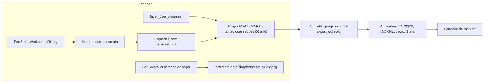

# Etapa 0 / SKILL 01 — Subfase 0A: Auditoria técnica

**Data:** 2026-10-07
**Escopo:** FortSmart Precision Planner (alvo do painel AgroCAD) e FortSmart Precision Ag (exportador protegido)
**Natureza:** somente leitura. Nenhum arquivo `.py`, `metadata.txt` ou recurso dos dois plugins foi alterado.

Esta auditoria descreve o estado real dos dois plugins, sem nomes inventados, e define os pontos seguros de integração para as Subfases 0B a 0G.

---

## 1. Visão geral

| Item | FortSmart Precision Planner | FortSmart Precision Ag |
|---|---|---|
| Pasta do código | `C:\Users\fortu\Desktop\PYTHON\plugin\fortsmart_precision` | `C:\Users\fortu\Desktop\QGIS_Python_NDVI\qgis_plugin\fortsmart_gs3_import` |
| Pasta instalada | `%APPDATA%\QGIS\QGIS3\profiles\default\python\plugins\fortsmart_precision` | `...\plugins\fortsmart_gs3_import` |
| Versão | 0.1.0 (`metadata.txt`), QGIS mínimo 3.34 | 2.9.20, QGIS mínimo 3.16 |
| Controle de versão | sem git | sem git |
| Arquivos `.py` | 207 | 70 |
| Fonte = instalado? | **Sim**: 209 de 209 arquivos com o mesmo SHA-256 em 2026-10-07 | Sim (instalado pelo script `install_fortsmart_gs3_plugin.ps1`) |
| Papel | Planejamento: bordadura, passadas, plantio, pulverização, obstáculos, desvios, manobras, simulação | Importação e exportação para monitores (John Deere, 20\|20, ISOXML, Jacto, Stara) |
| Testes | `tests/` com 113 arquivos (94 unit, 17 qgis, 2 integration) | `tests/` com 15 arquivos (1 exige QGIS) |

Backup feito antes da auditoria: `C:\Users\fortu\Desktop\PYTHON\plugin\backups\fortsmart_precision_antes_etapa0_20261007_221536` (209 arquivos, sem `__pycache__`).

### 1.1 Fluxo entre os plugins



O contrato entre os dois plugins são **as propriedades das camadas** (`fortsmart_role` e chave interna) e **a árvore de grupos** (grupo do talhão contendo as seções). O Ag não importa código do Planner.

---

## 2. Entrada e interface do Planner

### 2.1 Ponto de entrada

- `__init__.py:1-4`: `classFactory` retorna `FortSmartPrecisionPlugin` (`plugin.py:27`).
- `provider.py:21`: `FortSmartProvider`, id `fortsmart_precision`, com 13 algoritmos de Processing.
- `initGui` (`plugin.py:57-161`) cria o menu **FortSmart Precision**:

| Ação | Callback | Abre |
|---|---|---|
| Planejamento Precision Lines (toolbar) | `open_workspace` | **novo** `FortSmartWorkspaceDialog` a cada clique |
| Painel do projeto (toolbar) | `open_panel` | `FortSmartDock` (reutilizado) |
| Criar projeto / Abrir projeto | `create_project` / `open_project` | via dock |
| Importar camada (toolbar) | `import_layer` | `ImportWizard` (modal) |
| Conversor de zona / CRS | `open_crs_converter` | `CrsZoneConverterDialog` (modal) |
| Cortar linhas por obstaculos | `open_line_cut` | novo `PlantingLineCutDialog` |
| Desvio de Obstáculo (toolbar) | `open_obstacle_detour` | `ObstacleDetourDialog` (instância única) |
| Manobras de cabeceira | `open_headland_turns` | novo `HeadlandTurnsDialog` |
| Comparar projeção de plantio | `open_strategy_analyzer` | só se `ENABLE_STRATEGY_ANALYZER`; chama método privado do workspace (`plugin.py:224`) |
| Organizar camadas FortSmart | `organize_layers` | `normalize_legacy_project_layers()` |
| Persistir camadas FortSmart | `persist_layers` | `persist_generated_memory_layers()` |
| Simulador de Operacao (toolbar) | `open_route_simulator` | `RouteSimulationDialog` (instância única) |
| Raio-X de cobertura | `open_operation_simulator` | `processing.execAlgorithmDialog("fortsmart_precision:simulate_real_operation")` |
| Validar projeto para exportacao | `open_export_readiness` | novo `ExportReadinessDialog` |
| Sobre | `show_about` | caixa de mensagem |

- `open_panel` (`plugin.py:226-234`) tem o caminho padrão `parents[2]/"Projeto_FortSmart_Teste"` fixo no código.
- `unload` (`plugin.py:163-209`) remove menus, ícones e provider e fecha apenas `route_simulation_dialog` e `obstacle_detour_dialog`. Não fecha `workspace_dialog`, `line_cut_dialog`, `headland_turns_dialog` nem `export_readiness_dialog`, não desconecta sinais do `QgsProject` e não restaura map tool ativo.

### 2.2 Dock existente

Único dock: `FortSmartDock` (`gui/main_dock.py:29`).
- Mostra `StartPage` ou `ProjectStatusWidget` + `LayerSummaryWidget("CAMADA ATIVA")`.
- Botões Criar, Abrir e Importar funcionam. **Validar, Planejar e Exportar estão sempre desabilitados** (linhas 82-84 e 174-176): são placeholders.
- Conecta `iface.currentLayerChanged` (93) e desconecta em `closeEvent` (99).
- **Defeito A:** ao fechar pelo X e reabrir, `open_panel` só chama `show()` e o sinal não é reconectado. O painel para de acompanhar a camada ativa.
- **Defeito B:** no `unload`, `removeDockWidget` não dispara `closeEvent`, e o sinal fica ligado a um widget órfão.

### 2.3 Diálogos

| Arquivo (linhas) | Classe | Observação |
|---|---|---|
| `gui/fortsmart_workspace_dialog.py` (4044) | `FortSmartWorkspaceDialog` | Abas "1. Camadas / A-B", "2. Aplicacao", "3. Plantio", "4. Obstaculos", "5. Cruzamento". Geração em `QThread` (`PrecisionLinesWorker`). `_render_preview_layers` (3262-3892) cria as 15 camadas `01_` a `15_` e grava no GPKG se o projeto estiver salvo |
| `gui/planting_line_cut_dialog.py` (1339) | `PlantingLineCutDialog` | Corte e retomada; previews `SIM_*` em `SIM_PREVIEW`; salva `31_Linhas_Finais`, `32_Work_Off`, `33_Work_On`, `35_Linhas_Bordadura` |
| `gui/strategy_dialog.py` (775) | `StrategyAnalyzerDialog` | Previews `PREVIEW_RETA*`/`PREVIEW_CURVA`; salva `12_Passadas_Plantio` |
| `gui/headland_turns_dialog.py` (565) | `HeadlandTurnsDialog` | Preview em camada de memória; salva `16_Manobras_Cabeceira` |
| `gui/obstacle_detour_dialog.py` (548) | `ObstacleDetourDialog` | **Já usa só `QgsRubberBand`** no preview; ao aplicar edita a camada de linhas (com Ctrl+Z) e cria `FortSmart_Desvios_Obstaculos` sem metadado de role |
| `gui/route_simulation_dialog.py` (568) | `RouteSimulationDialog` | `FORTSMART_SIMULATION_COVERAGE`, `FORTSMART_ROUTE_WARNINGS`; renderizadores com rubber band |
| `gui/crs_zone_converter_dialog.py` (501) | `CrsZoneConverterDialog` | Cópias `"<nome> (EPSG:n)"` sem metadados FortSmart |
| `gui/import_wizard.py` (272) | `ImportWizard` | Camadas `FortSmart - {tipo} - {origem}` |
| `gui/export_readiness_dialog.py` (176) | `ExportReadinessDialog` | Somente leitura |

**Diálogos órfãos** (nenhuma ação os abre): `AgriculturalLinesDialog` (705 linhas), `OperationConfigurationDialog` (891) com `TurnsAndHeadlandsTab`, `PrecisionLinesDialog` (288) e `ObstacleAvoidanceDialog` (386).

### 2.4 Map tools e previews no canvas

- `CaptureABLineTool(QgsMapTool)` em `gui/maptools/capture_ab_line_tool.py:12`: usa `QgsRubberBand`, mas a banda **nunca é removida da cena**, e cada captura cria uma nova ferramenta.
- Ferramentas nativas usadas: `QgsMapToolIdentifyFeature` (`obstacle_detour_dialog.py:369`) e `QgsMapToolEmitPoint` (`route_warning_panel.py:257`), ambas com limpeza.
- `QgsRubberBand` com limpeza correta: `obstacle_detour_dialog.py:76` (`DetourPreview`), `route_simulation_renderer.py:46`, `route_warning_renderer.py:52`.
- `QgsVertexMarker`: nenhum uso.

### 2.5 Seleção, contexto e settings

- **Seleção:** só leituras pontuais (`selectedFeatures`, `selectedFeatureIds`) em cerca de 12 lugares. **Nenhum** handler de `selectionChanged`.
- **Contexto do projeto:** não há serviço central. O talhão é resolvido de formas diferentes em `fortsmart_workspace_dialog._current_field_name` (3220), `headland_turns_dialog._field_name` (451), `planting_line_cut_dialog._field_name` (813), `layer_tree_organizer.field_name_for_layer` (238) e `resolve_export_field_id`.
- **CRS métrico** implementado pelo menos 5 vezes: `headland_turns_dialog._metric_crs`, `planting_line_cut_dialog._metric_crs`, `route_simulation_source.metric_crs_for_layer`, `obstacle_detour_service.metric_crs_for` e `metric_work_context.resolve_metric_target_crs`.
- **Settings:** `QgsSettings` em `fortsmart_precision/work_geometry/*` e `fortsmart_precision/headland_turns/min_turn_radius_m`. `lateral_detour_widget.py` usa `QSettings` em `fortsmart_precision/lateral_detour/*`. As configurações de máquina não são persistidas.
- **Imports Qt:** nenhum `PyQt5` direto; a regra do `AGENTS.md` está sendo cumprida. O código usa o construtor deprecado `QgsField(nome, QVariant.X)`, que gera cerca de 4 mil avisos nos testes QGIS.

### 2.6 Feature flags

| Flag | Definição | Leitura |
|---|---|---|
| `ENABLE_STRATEGY_ANALYZER = True` | `feature_flags.py:4` | `plugin.py:118`, `fortsmart_workspace_dialog.py:367` |
| `SHOW_ROW_PREVIEW = False` | `feature_flags.py:6` | **nenhum lugar (flag morta)** |
| `ENABLE_LATERAL_DETOUR = True` | `domain/obstacle_strategy.py:16` (fora de `feature_flags.py`) | `obstacle_strategy.py:116`, `lateral_detour_widget.py:157, 185` |

Todas são constantes de módulo. Nenhuma é persistida em `QgsSettings`.

---

## 3. Motores protegidos do Planner

Os motores são majoritariamente Python puro (shapely/numpy). Importam `qgis.core` apenas `export_readiness_validator`, `persistence_manager`, `layer_roles` (lazy), `strategy_preview` e `strategy_save`.

| Grupo | Arquivos principais | Situação |
|---|---|---|
| Linha AB / guiamento | `core/ab_direction.py`, `core/guidance_engine.py` (`generate_traffic_passes`), `core/tractor_axis_engine.py`, `domain/guidance_reference.py`, `domain/precision_project.py` | Protegido |
| Curva / adaptativa | `strategy_analyzer/curve_strategy.py`, `core/line_geometry.py` (1709 linhas; base geométrica usada por quase tudo) | Protegido |
| Bordadura | `core/boundary_engine.py` (`build_boundary_plan`), `core/headland_fidelity_engine.py`, `core/boundary_simplify.py`, `domain/boundary_areas.py`, `domain/headland_layout.py` | Protegido |
| Passadas e plantio | `core/parallel_pass_engine.py`, `core/row_engine.py`, `core/planting_kinematics_engine.py`, `core/precision_lines_engine.py` (`run_precision_lines`, orquestrador) | Protegido |
| Obstáculos: modelo e buffer | `domain/obstacle_model.py`, `domain/obstacle_strategy.py`, `core/obstacle_buffer_engine.py`, `core/obstacle_grouping_engine.py`, `core/spatial_index.py` | Protegido |
| Obstáculos: desvio e corte | `core/application_obstacle_engine.py` (2300 linhas), `core/planting_obstacle_engine.py`, `core/obstacle_engine.py`, `core/obstacle_border_pass_engine.py`, `core/longitudinal_cut_engine.py`, `core/planting_line_cut_engine.py`, `core/lateral_detour/`, `core/obstacle_strategy_controller.py`, `core/obstacle_detour/`, `core/obstacle_ring_bypass.py`, `core/obstacle_contour_path.py` | Protegido |
| Simulação | `core/route_simulation_engine.py`, `core/simulation_route.py`, `core/coverage_engine.py`, `core/visual_coverage_engine.py`, `domain/operation_simulation.py` | Protegido |
| Shutoff e tramline | `core/shutoff_engine.py`, `core/tramline_engine.py`, `core/tire_track_engine.py`, `core/cross_workflow.py` | Protegido |
| Manobras | `core/headland_turn_engine.py`, `core/turn_path_engine.py`, `core/pass_sequence_engine.py`, `core/spray_headland_turns.py` | Protegido |
| CRS | `core/crs.py` (`require_projected_metric`, `suggest_sirgas_utm_epsg`), `core/zone_converter.py` | Reutilizável |
| Validação | `core/export_readiness_validator.py` (`CanonicalExportReadinessValidator`), `validator/` (`RouteValidatorEngine`), `validators/`, `core/validation_engine.py` | Protegido |

**Terreno / DEM:** não existe código. Só há `StrategyType.TERRAIN` reservado (`strategy_analyzer/models.py:48`, fora de `IMPLEMENTED_STRATEGIES`) e a pasta `02_RASTERS` criada pelo `project_manager`.

**Obstáculos, cadastro:** camada canônica `21_Obstaculos_RTK` (role `OBSTACLE`, ponto, seção `20_OBSTACULOS`). A conversão de feições em `Obstacle` acontece na GUI (`fortsmart_workspace_dialog.py:1994-2048`). Os motores usam quatro contratos de entrada diferentes: `Obstacle`, `longitudinal_cut_engine.ObstacleInput`, `(id, geometria)` e `validator.obstacle_validator.ObstacleInput`.

**Threads:** só `PrecisionLinesWorker(QThread)`. Não há `QgsTask`. **Risco:** `_pump_ui_events()` chama `QApplication.processEvents()` dentro de `precision_lines_engine`, `application_obstacle_engine` e `planting_obstacle_engine`, inclusive quando esses motores rodam dentro do worker, fora da thread principal.

**Código sem uso** (importado só por testes): `core/adaptive_curve_import_engine.py`, `core/planter_row_preview.py`, `core/seed_corn_turn_engine.py`, `domain/headland_configuration.py`, `domain/tire_shutoff_model.py`.

**Dependências invertidas:**
- seis algoritmos importam `gui.agricultural_lines_dialog` (`qgs_geometry_to_multipolygon`, `to_qgs_point`);
- `strategy_save.py` importa `gui.layer_tree_organizer`;
- `domain/obstacle_model.py` importa `core.line_geometry`.

---

## 4. Camadas, organização, preview e persistência do Planner

### 4.1 Catálogo de papéis (`core/layer_roles.py`)

- **Propriedades gravadas por `set_layer_role_properties`** (488-510):
  - `fortsmart_role`, `fortsmart_precision/role`, `fortsmart_precision/section`, `fortsmart_section`;
  - `fortsmart_internal_key`, `fortsmart_generated`, `fortsmart_project`, `fortsmart_field_id`, `fortsmart_schema_version` (`SCHEMA_VERSION = 1`, inteiro).
- **Outras marcas:**
  - `fortsmart_temporary_preview`, `fortsmart_temporary`, `fortsmart_preview`;
  - `fortsmart_original_name`, `fortsmart_original_group_path`, `fortsmart_classified_by`;
  - `fortsmart_storage`, `fortsmart_persisted`, `fortsmart_updated_at`, `fortsmart_source_layer_id`;
  - legado: `fortsmart_precision/preview_layer`.
- **Ordem de classificação** (`classify_layer`, 400-431): `role` → `internal_key` → `legacy_alias` → `display_name` → `heuristic`. O atributo por feição e a geometria **não** entram.
- **Grupos:** talhão `FORTSMART - <talhão>`. Seções em `SECTION_ORDER`: `00_REFERENCIAS`, `10_PLANEJAMENTO`, `20_OBSTACULOS`, `30_OPERACAO`, `40_SIMULACAO`, `90_AUXILIARES`. Preview em `SIM_PREVIEW`.
- **Metadados gravados e nunca lidos:** `fortsmart_project`, `fortsmart_precision/section`. `fortsmart_original_group_path` e `fortsmart_original_name` são gravados, mas **não existe função de restaurar**.

### 4.2 Organizador existente (`gui/layer_tree_organizer.py`)

- `project_group` (62-67), `section_group` (81-92), `preview_group` (95-99).
- **Movimentação:** `_move_node` (116-121) faz `insertChildNode(pos, node.clone())` e depois `removeChildNode(node)`. O clone entra antes da remoção, então **a camada não sai do projeto**. Isso já foi validado e pode ser reutilizado na 0C.
- `normalize_legacy_project_layers` (317-365), chamado pela ação "Organizar camadas FortSmart", move camadas soltas do usuário para `90_AUXILIARES` e as geradas para a seção certa.
- **Remoções implícitas existentes:**
  - `publish_persisted` (233-234) e `place_generated_result` (272-273) removem outras camadas geradas com o mesmo role no talhão;
  - `_clear_preview` do workspace (4010-4044) remove o grupo legado `_fortsmart_workspace_` **com tudo o que houver dentro**, inclusive camadas do usuário.

### 4.3 Previews

- **Workspace:** o "preview" já é o resultado final: 15 camadas, gravadas no GPKG quando o projeto está salvo.
- **Previews temporários em camada** (`SIM_PREVIEW`):
  - camadas `SIM_*` do corte;
  - `*_Preview` do desvio lateral (`gui/lateral_detour_preview.py:92`);
  - `16_Manobras_Cabeceira (pré-visualização)`;
  - `PREVIEW_RETA*` / `PREVIEW_CURVA` (`strategy_analyzer/strategy_preview.py:76`).
- **Simulador:** `FORTSMART_SIMULATION_COVERAGE` e `FORTSMART_ROUTE_WARNINGS`. São camadas por necessidade técnica: transparência acumulada e map tips.
- **Já em rubber band:** desvio manual de obstáculo, renderizadores de rota e de alertas.
- `findGroup("SIM_PREVIEW")` é recursivo, então previews do simulador podem cair no `SIM_PREVIEW` de outro talhão.

### 4.4 Persistência

- **GPKG por talhão:** `<pasta do .qgs>\fortsmart_data\<slug>\fortsmart_<slug>.gpkg`. Uma tabela por role (nome = `display_name`), versões `<tabela>_v{n}`. Único gravador: `FortSmartPersistenceManager`.
- **GPKG mestre:** `01_BANCO\fortsmart.gpkg`, tabelas `fs_*` e algumas de geometria. A coluna `geom` é gravada como **GeoJSON em texto** (`io/import_service.py:426`), não no formato binário do GeoPackage.
- **Mistura de geometrias:**
  - `22_Zonas_Seguranca` recebe Polygon do workspace e MultiPolygon do corte; a substituição usa `ogr.ForceTo`.
  - `FINAL_WORK_PATH` e `SAFETY_ZONE` têm dois produtores gravando a mesma tabela.

---

## 5. Contratos do FortSmart Precision Ag (protegido)

### 5.1 Identificação de camadas (`canonical_project.py`)

- **Propriedades lidas:** `fortsmart_role` / `fortsmart_precision/role`, `fortsmart_internal_key` / `fortsmart_precision/internal_key`, `fortsmart_schema_version`. O valor é convertido para maiúsculas.
- **Atributos lidos:** `fortsmart_role` / `role` (constante nas primeiras 64 feições, ou por feição) e `fortsmart_internal_key` / `internal_key`.
- **Ordem de `resolve_layer`** (448-477): propriedade `fortsmart_role` → atributo constante → chave interna em `INTERNAL_KEY_ROLES` → `role_from_layer_name(nome, geometria)` (`legacy_alias`). O valor da propriedade **não é validado** contra a geometria.
- `UNTRUSTED_RESOLUTIONS = {"legacy_name", "geometry_heuristic"}` (`jd_guidance_plan.py:98`).

### 5.2 Identificação do talhão (`field_group_export.py`)

`_field_node` (30-66) escolhe o grupo do talhão nesta ordem:
1. ancestral que **contém** um filho chamado `00_REFERENCIAS`, `10_PLANEJAMENTO`, `20_OBSTACULOS` ou `30_OPERACAO` (`SECTIONS`, linha 13);
2. ancestral com nome `TL...`, `TALHAO...` ou `FIELD...`;
3. primeiro ancestral que não seja seção e não comece com `FortSmart`.

O nome do talhão enviado ao monitor é o nome do grupo, editável no diálogo "Talhoes a exportar". O `field_erid` é `uuid5("qgis-field", nome)`, a menos que as feições tragam um atributo `field_erid` válido.

### 5.3 Writers e papéis aceitos

| Perfil | Writer | Papéis aceitos |
|---|---|---|
| `john_deere_gs3` | `DeereGS3Writer` | EXTERNAL, OPERATIONAL, INTERNAL_BOUNDARY, HEADLAND, AB_LINE, AB_CURVE, GUIDANCE_TRACK |
| `john_deere_gen4` | `DeereGen4Writer` | EXTERNAL, OPERATIONAL, AB_LINE, AB_CURVE, GUIDANCE_TRACK, OBSTACLE |
| `john_deere_dual` | `DeereDualWriter` | GS3 + OBSTACLE |
| `isoxml_v4`, `isoxml_v3`, `cnh`, `fendt`, `precision_planting` | `ISOXMLWriter` | GS3 + OBSTACLE, SAFETY_ZONE, WORK_PATH, FINAL_WORK_PATH, FIELD_HEADLAND_PATH, OBSTACLE_DETOUR, SHUTOFF |
| `jacto`, `stara` | `JactoWriter`, `StaraWriter` | EXTERNAL, OPERATIONAL, HEADLAND, AB_LINE, AB_CURVE, GUIDANCE_TRACK |
| `sendto2020` | `SendTo2020Writer` | só EXTERNAL_BOUNDARY |

Passadas John Deere: `WORK_PATH` vira plantio e `FIELD_HEADLAND_PATH` vira bordadura. `FINAL_WORK_PATH` vira plantio somente quando o talhão não tem `WORK_PATH`.

**Situação de validação declarada no código:**
- **Limites e curvas John Deere:** referência de pacotes aceitos (golden PL-38L).
- **Passadas GS3 e Gen4:** `READY_FOR_DEVICE_TEST`, ou seja, ainda precisam de teste no monitor.
- **20|20:** `ROUNDTRIP_TESTED` em software; `PRECISION2020_DEVICE_STATUS = READY_FOR_DEVICE_TEST`.
- **ISOXML, CNH, Fendt, Jacto, Stara:** sem marca de validação.

### 5.4 Interface do Ag

Menu `&FortSmart` com 4 ações: Exportar Projeto, Exportar para monitor, Importar do pendrive, Ferramentas. **Não tem dock.** `unload` remove as ações e limpa `sys.modules` (`_purge_plugin_modules`). A árvore só é alterada no import (`field_layers.add_organized_field_layers`); a exportação nunca move camadas.

---

## 6. Catálogo cruzado de papéis

A tabela parte da lista de referência da especificação da Etapa 0. A regra 5.2 da especificação (não alterar valores existentes) significa que `ADAPTIVE_CURVE` e `BORDER_PASS` são **nomes conceituais** e devem ser mapeados para os valores que já existem, sem criar valores novos.

| Papel na especificação | Valor real | Planner (chave → exibição, seção) | Ag (`ROLE_KIND_MAP`) | Geometria | Exportado por | Ação |
|---|---|---|---|---|---|---|
| EXTERNAL_BOUNDARY | `EXTERNAL_BOUNDARY` | `01_Limite_Externo` → `01_Limite_Externo` (00) | `LIMITE` | polígono | todos | KEEP |
| INTERNAL_BOUNDARY | `INTERNAL_BOUNDARY` | `03_Limite_Interno` → **`02_Limite_Interno`** (00) | `LIMITE_INTERNO` | polígono | GS3, Dual, ISOXML | KEEP |
| HEADLAND | `HEADLAND` | `02_Bordadura` → **`03_Bordadura`** (00) | `BORDADURA` | polígono | GS3, Dual, ISOXML, Jacto, Stara | KEEP |
| AB_LINE | `AB_LINE` | `04_Linha_AB` (00) | `LINHA_AB` | linha | todos menos 20\|20 | KEEP |
| AB_CURVE | `AB_CURVE` | **não existe camada no catálogo** | `CURVA_AB` | linha | JD, ISOXML, Jacto, Stara | REVIEW |
| ADAPTIVE_CURVE | `GUIDANCE_TRACK` | `05_Passadas` → `11_Passadas` (10) | `CURVA_ADAPTADA` | linha | JD, ISOXML, Jacto, Stara | KEEP (nome conceitual) |
| BORDER_PASS | `FIELD_HEADLAND_PATH` | `15_Passadas_Bordadura` (10) | `TRABALHO` | linha | ISOXML; guidance JD | KEEP (nome conceitual) |
| — | `HEADLAND_WORK_PATH` | `FINAL_BORDER_PASS` → `35_Linhas_Bordadura` (30) | **desconhecido** | linha | nenhum | REVIEW |
| WORK_PATH | `WORK_PATH` | `06_Passadas_Plantio` → `12_Passadas_Plantio` (10) | `TRABALHO` | linha | ISOXML; guidance JD | KEEP |
| FINAL_WORK_PATH | `FINAL_WORK_PATH` | `12_Linhas_Finais` e `SIM_WORK_LINES` → `31_Linhas_Finais` (30) | `TRABALHO` | linha | ISOXML; guidance JD (fallback) | REVIEW (dois produtores) |
| OBSTACLE | `OBSTACLE` | `09_Obstaculos_RTK` → `21_Obstaculos_RTK` (20) | `OBSTACULO_PONTO`/`_AREA` | ponto | Gen4, Dual, ISOXML | KEEP |
| — | `SAFETY_ZONE` | `10_Zonas_Seguranca` e `SIM_SAFETY_ZONE` → `22_Zonas_Seguranca` (20) | `OBSTACULO_AREA` | polígono | ISOXML | REVIEW (dois produtores) |
| — | `OBSTACLE_DETOUR` | `11_Desvios_Obstaculos` → `23_Desvios_Obstaculos` (20) | `TRABALHO` | polígono no Planner | ISOXML | REVIEW (geometria) |
| WORK_OFF / WORK_ON | `WORK_OFF` / `WORK_ON` | `SIM_WORK_OFF/ON` → `32_Work_Off` / `33_Work_On` (30) | `TRABALHO` | ponto | nenhum | KEEP |
| SHUTOFF | `SHUTOFF` | `13_Shutoff` → `34_Shutoff` (30) | `TRABALHO` | linha | ISOXML | KEEP |
| HEADLAND_TURN | `HEADLAND_TURN` | `16_Manobras_Cabeceira` (10) | `TRABALHO` | linha | nenhum | KEEP |
| — | `OPERATIONAL_BOUNDARY` | `14_Limite_Operacional` → `05_Limite_Operacional` (00) | `LIMITE` | polígono | todos menos 20\|20 | KEEP |
| — | `TRACTOR_PATH`, `TIRE_TRACK` | `13_Linha_Trator`, `14_Rastros_Pneus` (10) | `TRABALHO` | linha | nenhum | KEEP |
| — | `MARKER` | não existe | `MARCAÇAO` | ponto | nenhum | KEEP (só Ag) |
| — | `COVERAGE`, `OVERLAP`, `GAP`, `MACHINE_PATH`, `IMPLEMENT_SWATH`, `HEADLAND_SWATH`, `ACTIVE_ROW_PATH`, `HEADLAND_PATH`, `UNWORKED_AREA` | `41_` a `49_` (40) | **desconhecidos** | área ou linha | nenhum | REVIEW |
| — | `ROW_PATH`, `LATERAL_DETOUR_PATH`, `MASTER_PATH`, `OBSTACLE_CLEARANCE` | fora do catálogo (`36_`, `37_`, previews do desvio lateral) | **desconhecidos** | linha ou área | nenhum | REVIEW |

**Chaves internas:** as 15 do Planner (`01_Limite_Externo` ... `15_Passadas_Bordadura`) coincidem com `INTERNAL_KEY_ROLES` do Ag depois da conversão para maiúsculas. O contrato é compatível.

**Metadados:** `fortsmart_schema_version` é gravado como inteiro `1` pelo Planner e como texto `"1"` pelo Ag (`field_layers.py:270`). Nenhum dos dois compara o valor; só a presença é verificada. A chave `fortsmart_field_id` é gravada pelo Planner e ignorada pelo Ag.

---

## 7. Recursos nativos do QGIS 3.44.13 confirmados

Verificado contra a instalação `C:\Program Files\QGIS 3.44.13` (Qgis.version() = `3.44.13-Solothurn`).

| Necessidade (especificação) | Recurso nativo | Uso na Etapa 0 |
|---|---|---|
| Selecionar, caixa, polígono, raio, mão livre | `iface.actionSelect`, `actionSelectRectangle`, `actionSelectPolygon`, `actionSelectRadius`, `actionSelectFreehand` | Acionar a partir do painel |
| Editar vértices | `iface.actionVertexTool`, `actionVertexToolActiveLayer` | Acionar (exige camada em edição) |
| Cortar | `iface.actionSplitFeatures`, `actionSplitParts` | Acionar |
| Emendar / unir | **sem método em `QgisInterface`**; existe no menu de edição da janela principal | Deixar indisponível na Etapa 0 ou localizar a ação pelo `objectName` com fallback; decidir na 0D |
| Desfazer / refazer | **sem método em `QgisInterface`**; `layer.undoStack()` (`QUndoStack.undo/redo`) | Usar o `undoStack` da camada ativa |
| Edição | `iface.actionToggleEditing`, `actionSaveActiveLayerEdits` | Acionar |
| Simplificar | `iface.actionSimplifyFeature` | Não expor na Etapa 0 |
| Preview | `QgsRubberBand` (`setToGeometry`, `addGeometry`, `reset`, `setStrokeColor`, `setFillColor`, `setWidth`, `setLineStyle`) e `QgsVertexMarker` (`setCenter`, `setIconType`, `setIconSize`) | Base do `PreviewManager` |
| Escolher raster | `QgsMapLayerComboBox` com `Qgis.LayerFilter.RasterLayer` | Inspetor DEM |
| Propriedades do raster | `QgsRasterLayer.bandCount`, `crs`, `extent`, `rasterUnitsPerPixelX`, `dataProvider` | Inspetor DEM |
| Análises de terreno (Etapa 2) | `native:slope`, `native:aspect`, `native:hillshade`, `gdal:slope`, `gdal:contour`, `native:rastersampling`, `native:setzfromraster`, `native:zonalstatisticsfb` (todos presentes) | Reutilizar na Etapa 2 em vez de motor próprio |

---

## 8. Inventário por componente

| Componente | Situação | Ação |
|---|---|---|
| Motores `core/`, `domain/`, `algorithms/`, `strategy_analyzer/`, `validator/` do Planner | Validados por 1.145 testes (992 unit/integration, 153 QGIS) | KEEP |
| Exportadores do Ag (`adapters/*_writer.py`, `gs3_*`, `gen4_*`, `sendto2020_*`, `isoxml_*`) | Protegidos, com linha de base de hashes | KEEP |
| `canonical_project.py`, `export_collector.py`, `field_group_export.py` (Ag) | Contrato de leitura das camadas | KEEP |
| `core/layer_roles.py` (Planner) | Catálogo central de papéis já existente | REUSE como base do catálogo lógico (0B) |
| `gui/layer_tree_organizer.py` | Movimentação segura com clone + remove já existente | REUSE na organização reversível (0C) |
| `gui/main_dock.py` (`FortSmartDock`) | Dock existente, com botões placeholder e defeitos de sinal | MODIFY com cuidado ou hospedar o painel AgroCAD atrás da flag (0D) |
| `gui/obstacle_detour_dialog.py` (`DetourPreview`) e `route_*_renderer.py` | Rubber bands com limpeza correta | REUSE como referência do `PreviewManager` (0E) |
| `core/crs.py`, `gui/metric_work_context.py` | Regras de CRS métrico | REUSE no serviço de contexto (0B) |
| `feature_flags.py` | Flags como constantes de módulo | MODIFY: novas flags persistidas em `QgsSettings` sob `fortsmart_precision/flags/*` (0B) |
| Serviço de contexto do projeto | Não existe (lógica espalhada em 5+ lugares) | CREATE (0B), só leitura, sem substituir as funções atuais |
| Serviço central de seleção | Não existe | CREATE (0E) |
| `PreviewManager` | Não existe | CREATE (0E) |
| Inspetor DEM | Não existe | CREATE (0F) |
| Restaurar organização | Gravação parcial (`fortsmart_original_group_path`) sem leitura | CREATE (0C) |
| Defeitos A e B do dock; `unload` incompleto; sinais `layersAdded/layersRemoved` do workspace sem desconexão | Riscos de ciclo de vida | REVIEW (corrigir só o que o painel novo tocar; o resto é proposta separada) |
| `CaptureABLineTool` sem remover a banda da cena | Vazamento de item no canvas | REVIEW |
| `processEvents` dentro de motores que rodam em `QThread` | Risco de estabilidade | REVIEW (não mexer na Etapa 0: é motor protegido) |
| Dois produtores para `31_Linhas_Finais` e `22_Zonas_Seguranca` | Risco de sobrescrita | REVIEW |
| Roles desconhecidos pelo Ag (`HEADLAND_WORK_PATH`, `41_` a `49_`, `36_`, `37_`) | Não exportados | REVIEW |
| Prévia do Ag (2.9.20) conta limites externos sem o filtro de papéis dos writers | Pode mostrar "BLOQUEADA" falso com polígonos de simulação | REVIEW (correção pequena no Ag, fora da Etapa 0) |
| Nome de talhão `FORTSMART - <talhão>` enviado ao monitor sem edição | Nome com prefixo no monitor | REVIEW |
| GPKG mestre com `geom` em GeoJSON texto | Não legível como camada | DEFER |
| Diálogos órfãos (`AgriculturalLinesDialog`, `OperationConfigurationDialog`, `PrecisionLinesDialog`, `ObstacleAvoidanceDialog`) | Sem ação no menu | DEFER (não remover) |
| Módulos sem uso (`adaptive_curve_import_engine`, `planter_row_preview`, `seed_corn_turn_engine`, `headland_configuration`, `tire_shutoff_model`) e flag `SHOW_ROW_PREVIEW` | Mortos, mas testados | DEFER (não remover) |
| Duplicações (`ObstacleInput` x2, `ObstacleGroup` x2, CRS métrico x5, `to_shapely` x4, `validator/` x `validators/`) | Dívida técnica | DEFER |

---

## 9. Restrições obrigatórias para as próximas subfases

1. **Não renomear as seções.** O Ag identifica o talhão pelo grupo que contém `00_REFERENCIAS`, `10_PLANEJAMENTO`, `20_OBSTACULOS` ou `30_OPERACAO`. Se a 0C renomear para "01 — REFERÊNCIAS", a terceira regra do `_field_node` passa a tratar a própria seção como talhão, e a exportação para monitor junta ou separa talhões errado. A estrutura 01 a 05 da especificação deve ser só rótulo visual: tooltip, título no painel ou um mapeamento de exibição. Os nomes reais dos grupos ficam como estão.
2. **Manter a hierarquia por talhão.** A especificação desenha um único "FORTSMART — PROJETO AGRÍCOLA" com seções. O Planner e o Ag dependem de um grupo `FORTSMART - <talhão>` **por talhão**, com as seções dentro. A organização da 0C deve agrupar por talhão.
3. **Não criar valores de papel novos** para `ADAPTIVE_CURVE` e `BORDER_PASS`. Mapear para `GUIDANCE_TRACK` e `FIELD_HEADLAND_PATH`.
4. **Mover nós só com clone + remove** (`_move_node`), nunca com `takeChild`.
5. **Não remover camadas ao restaurar.** A restauração reposiciona nós; grupos criados pela organização só são apagados se estiverem vazios.
6. **Novos previews só em `QgsRubberBand`/`QgsVertexMarker`.** Os previews em camada existentes não são migrados na Etapa 0, porque migrar mudaria motores e diálogos. Ficam listados para a Etapa 1.
7. **Toda função nova com teste** (regra do `AGENTS.md`), registro no `CHANGELOG.md` e uso só de `qgis.PyQt`.
8. **Exportações equivalentes:** depois de cada subfase, rodar `docs/baseline_etapa0/gerar_baseline.py` e comparar com `ag_2.9.20_export_hashes.json`.

---

## 10. Pontos seguros de integração

| Subfase | Ponto de integração | Motivo |
|---|---|---|
| 0B Catálogo e contexto | Novo módulo de contexto que **lê** `layer_roles.classify_layer`, `find_layer_by_role`, `core/crs.py` e `layer_tree_organizer.field_name_for_layer` | Uma fonte única para o painel, sem alterar as funções usadas pelos motores |
| 0B Flags | Ampliar `feature_flags.py` com leitura de `QgsSettings` e padrão `False` para `ENABLE_AGROCAD_PANEL_V1`, `ENABLE_LAYER_ORGANIZER_V1`, `ENABLE_PREVIEW_MANAGER_V1`, `ENABLE_DEM_INSPECTOR_V1` | As flags atuais continuam constantes e intactas |
| 0C Organização | Nova ação "Organizar Camadas (reversível)" atrás de `ENABLE_LAYER_ORGANIZER_V1`, usando `_move_node`, com instantâneo da árvore (grupos, ordem, visibilidade, ids) guardado no projeto | A ação "Organizar camadas FortSmart" atual continua igual |
| 0D Painel | Novo `QDockWidget` AgroCAD atrás de `ENABLE_AGROCAD_PANEL_V1`, aberto por ação própria; o `FortSmartDock` atual permanece | Com a flag desligada, nada muda |
| 0D Planejamento | Botões que chamam os callbacks existentes (`open_workspace`, `open_headland_turns`, `open_line_cut`, `open_obstacle_detour`, `open_route_simulator`) | Atalhos, sem duplicar telas |
| 0E Seleção | Serviço que escuta `iface.currentLayerChanged` e `layer.selectionChanged` da camada ativa, com conexão única e desconexão no `unload` | Sincronizado com a seleção nativa |
| 0E Preview | `PreviewManager` com `QgsRubberBand`/`QgsVertexMarker`, limpo ao cancelar, fechar o painel, em `QgsProject.cleared` e no `unload` | Sem camada permanente |
| 0F DEM | Inspetor somente leitura (`QgsRasterLayer`, `bandCount`, `crs`, `rasterUnitsPerPixelX`, NoData do provider, cobertura do limite do talhão) | Não cria camadas nem calcula declividade |

---

## 11. Linha de base (2026-10-07)

### 11.1 Testes

| Suíte | Comando | Resultado |
|---|---|---|
| Planner unit + integration | `py -3 -m pytest tests/unit tests/integration -q -p no:cacheprovider` (em `C:\Users\fortu\Desktop\PYTHON`) | **992 passaram, 46 pulados**, cerca de 160 s |
| Planner QGIS | `python-qgis-ltr.bat -m pytest tests/qgis -q -p no:cacheprovider` | **153 passaram**, cerca de 74 s (cerca de 4 mil avisos de `QgsField` deprecado) |
| Ag pytest | `py -3 -m pytest tests -q -p no:cacheprovider --ignore=tests/test_qgis_canonical_collector.py` (em `QGIS_Python_NDVI`) | **155 passaram**, 26 subtestes |
| Ag QGIS | `python-qgis-ltr.bat -m unittest tests.test_qgis_canonical_collector` | **14 passaram** (OK) |

`tests/qgis` do Planner exige o Python do QGIS; com `py -3` a coleta falha em `ModuleNotFoundError: qgis`.

### 11.2 Hashes de exportação

- Script: `docs/baseline_etapa0/gerar_baseline.py`.
- Resultado: `docs/baseline_etapa0/ag_2.9.20_export_hashes.json`.
- Dados: `talhao-6-a`, `talhao-6-b` e `th-6-a_b` de `IGUACU\MAPAS FERRADURA  JF\T 6 B C\th-6-a-b`.
- Perfis: `john_deere_dual` (com passadas de plantio e bordadura) e `sendto2020`.
- Cada combinação foi exportada duas vezes. Arquivos de texto são normalizados (UUIDs e datas viram marcadores) antes do hash.
- **Resultado:** 6 combinações (17 arquivos no dual, 11 no 20|20), **todas determinísticas**. Qualquer diferença futura é mudança real.

Reexecução:

```text
"C:\Program Files\QGIS 3.44.13\bin\python-qgis-ltr.bat" docs\baseline_etapa0\gerar_baseline.py C:\Users\fortu\Desktop\QGIS_Python_NDVI\qgis_plugin <novo.json>
```

### 11.3 Tempo de carga (QGIS sem interface, `iface` simulado)

| Plugin | `classFactory` | `initGui` | Módulos carregados |
|---|---|---|---|
| Planner | 245 ms | 2 ms | 163 (carregamento antecipado de quase todo o pacote) |
| Ag | 123 ms | 4 ms | — (o `unload` limpa os módulos) |

`initGui` e `unload` executaram sem erro nos dois. O painel novo deve importar seus módulos sob demanda para não somar tempo à abertura.

---

## 12. Riscos principais

1. **Renomear seções quebra a exportação para monitor** (seção 9, item 1). É o risco mais alto da Etapa 0.
2. **Ciclo de vida da interface:** workspace recriado a cada clique com sinais nunca desconectados, dock que perde o sinal ao reabrir e `unload` incompleto. O painel novo não pode repetir esses padrões e deve ter teste de abrir, fechar e reabrir.
3. **Remoções implícitas de camadas** em `publish_persisted`, `place_generated_result` e `_clear_preview`. A organização reversível não pode passar por essas rotinas.
4. **`processEvents` em motores executados em `QThread`.** Fora do escopo da Etapa 0, porque os motores são protegidos; fica registrado.
5. **Dois produtores por tabela** (`31_Linhas_Finais`, `22_Zonas_Seguranca`), com risco de sobrescrita. Fora do escopo; registrado.
6. **Previews em camadas permanentes.** A migração para rubber band mexe em diálogos protegidos e fica para a Etapa 1.
7. **Talhão identificado pelo nome da camada escolhida no combo** (workspace 3220-3223, corte 813-815). Escolher `01_Limite_Externo` cria `FORTSMART - 01_Limite_Externo` e um GPKG novo. O serviço de contexto da 0B não deve herdar essa regra sem validar.
8. **Cópias reprojetadas `(EPSG:n)` perdem as propriedades FortSmart** (`crs_reproject_service.py:107`) e passam a ser tratadas como camadas do usuário, tanto pelo organizador quanto pelo Ag.
9. **Conversão forçada de geometria no GPKG do talhão** (`ogr.ForceTo`, `persistence_manager.py:381-382`): um MultiPolygon com várias partes gravado numa tabela criada como Polygon tende a gerar geometria inválida.
10. **Contrato do Ag para cada grupo de talhão:**
    - um único limite (`EXTERNAL_BOUNDARY` **ou** `OPERATIONAL_BOUNDARY`, porque os dois viram `LIMITE`);
    - atributo `field_erid` igual em todas as camadas do talhão, se existir;
    - atributos `role`/`fortsmart_role` reservados para o papel da camada.

    Uma camada agregada "Todos — Limites" criada pelo import do Ag fica fora de qualquer talhão e aparece como "Sem grupo".
11. **Algoritmos de Processing sem teste próprio:** 10 dos 13. Só `simulate_obstacle_border_cut`, `simulate_real_operation` e, indiretamente, `import_field_boundary` e `validate_precision_project` são exercitados.

---

## 13. Proposta das próximas subfases

| Subfase | Entrega mínima | Critério de saída |
|---|---|---|
| 0B | `feature_flags` com `QgsSettings` (4 flags novas, padrão `False`); serviço de contexto somente leitura (projeto, talhão, CRS, camada ativa, camadas por papel, seleção, DEM ativo, edição) | Testes unitários e QGIS do contexto; suítes atuais verdes; hashes iguais |
| 0C | Organização reversível atrás de `ENABLE_LAYER_ORGANIZER_V1`: instantâneo, organização por talhão com as seções atuais, restauração | Testes de IDs, estilos, visibilidade, grupos, sem duplicar nem remover; hashes iguais |
| 0D | Dock AgroCAD com abas Editor, Obstáculos, Terreno e Planejamento, atrás de `ENABLE_AGROCAD_PANEL_V1`; ações nativas e atalhos para os diálogos existentes; ações sem integração confiável aparecem como indisponíveis | Abrir, fechar, reabrir, trocar de aba e fechar o projeto sem erro nem conexões duplicadas |
| 0E | Serviço de seleção sincronizado e `PreviewManager` com rubber bands | Nenhuma camada criada; limpeza em cancelar, fechar e trocar de projeto |
| 0F | Inspetor DEM somente leitura | Casos de teste da seção 20.4 da especificação |
| 0G | Regressão completa, tempos e documentação | Suítes verdes, hashes iguais, tempo de carga sem aumento relevante |

**Recomendação para a 0B:** começar pelas flags persistidas e pelo serviço de contexto somente leitura, que não tocam nenhum fluxo existente. É também preciso confirmar com o usuário a restrição da seção 9, item 1: a estrutura 01 a 05 será só visual.
